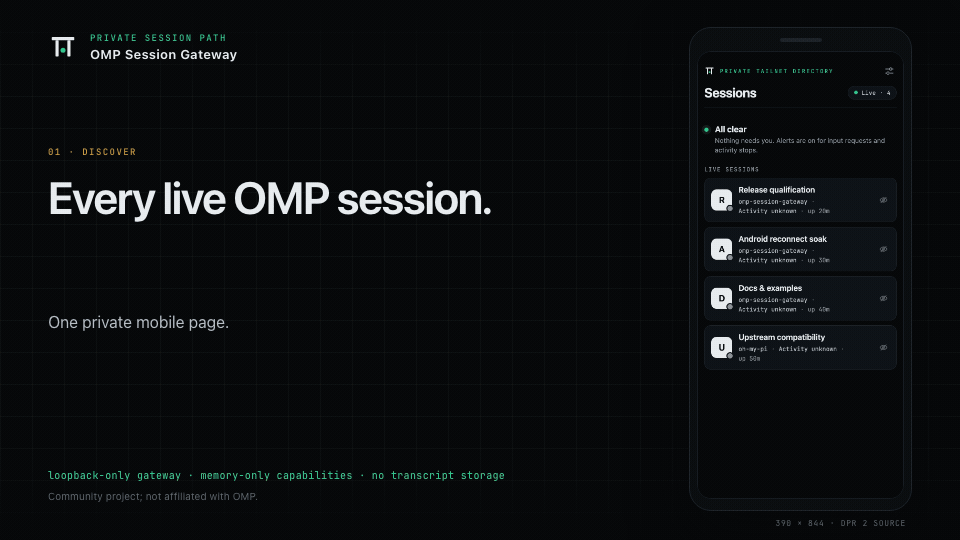
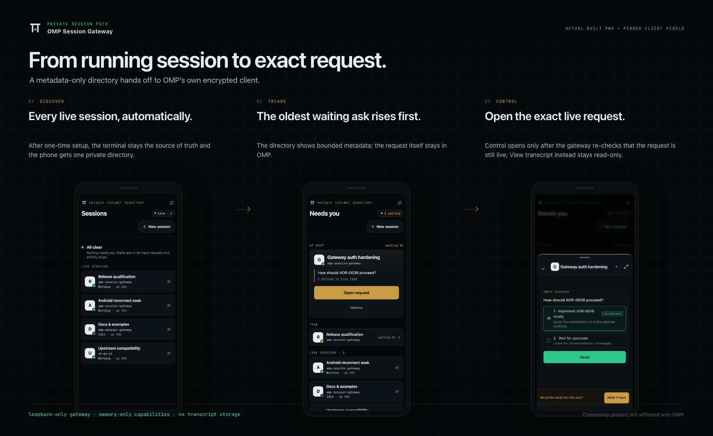
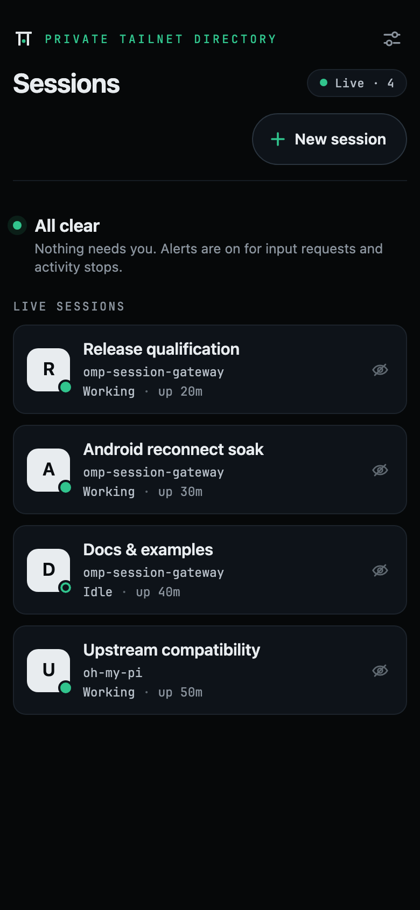
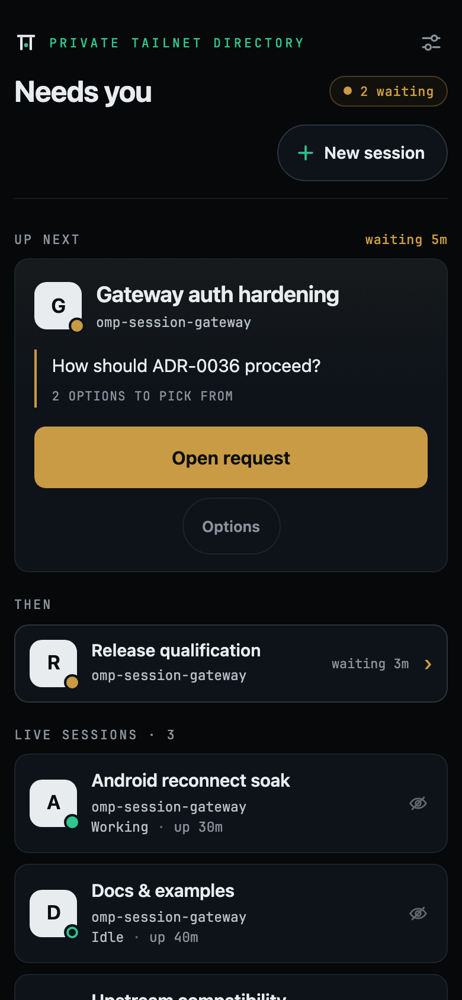
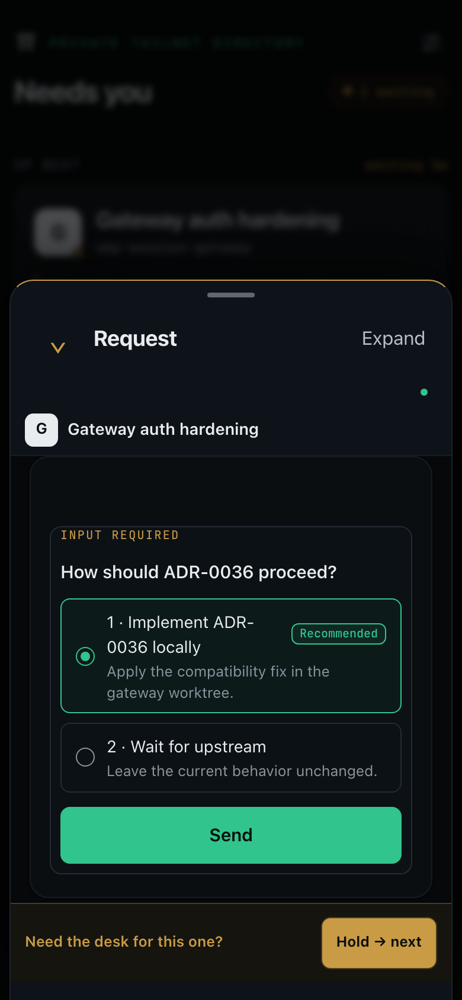
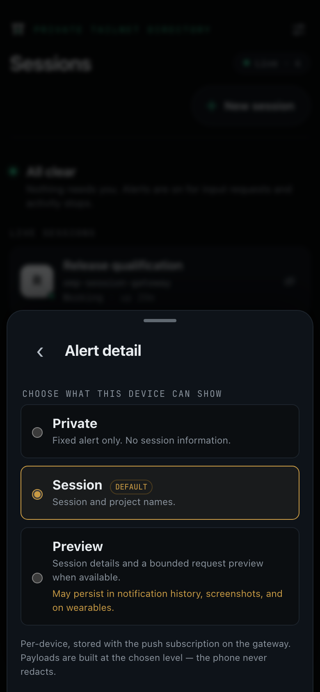

<div align="center">

<picture>
  <source media="(prefers-color-scheme: dark)" srcset="assets/logo.svg">
  <source media="(prefers-color-scheme: light)" srcset="assets/logo-light.svg">
  
</picture>

# OMP Session Gateway

**Every live OMP session. One private page, in any modern browser.**

Keep using [Oh My Pi](https://github.com/can1357/oh-my-pi) in your terminal. OMP Session Gateway lists your collaboration-enabled sessions, shows which need you, and opens OMP's own encrypted **View** or **Control** client from your phone — no QR scans, copied links, or per-session setup.



<sub>Synthetic product demo captured from the built app and pinned collaboration client (<a href="docs/media/README.md">capture provenance</a> · <a href="docs/media/omp-session-gateway-demo.mp4">MP4</a>).</sub>

**[Get started](#build-and-run)** · **[Docs](docs/README.md)** · **[Security](docs/SECURITY.md)** · **[Compatibility](docs/COMPATIBILITY.md)** · **[Latest release](https://github.com/carrythroughsystems/omp-session-gateway/releases/latest)**

[![CI][ci-badge]][ci]
[![Releases][release-badge]][releases]
[![License][license-badge]][license]

[ci]: https://github.com/carrythroughsystems/omp-session-gateway/actions/workflows/ci.yml
[ci-badge]: https://img.shields.io/github/actions/workflow/status/carrythroughsystems/omp-session-gateway/ci.yml?branch=main&label=CI&labelColor=0B0E11
[releases]: https://github.com/carrythroughsystems/omp-session-gateway/releases
[release-badge]: https://img.shields.io/github/v/release/carrythroughsystems/omp-session-gateway?filter=v*&label=release&color=C99B45&labelColor=0B0E11
[license]: LICENSE
[license-badge]: https://img.shields.io/github/license/carrythroughsystems/omp-session-gateway?color=1C232B&labelColor=0B0E11

Works with stock [OMP 18.1.20+](https://github.com/can1357/oh-my-pi/releases/tag/v18.1.20) — no fork or custom build.

</div>


## How it works

<div align="center">

</div>

1. **Discover automatically** — Every collaboration-enabled `omp` process appears in **OMP Sessions** on the next 10-second discovery poll, with no per-session command, QR code, or copied link.
2. **The oldest ask first** — When any session waits for input, **Needs you** shows which session is waiting and promotes the oldest ask; the prompt itself stays in OMP.
3. **One tap to the real session** — Tapping **Open request** or **View** opens OMP's own encrypted collaboration client on that exact request — the link is fetched when you tap and never stored.

<details>
<summary>Screens</summary>

<p>
  <br>
  <sub><strong>All clear:</strong> every live session listed automatically with no per-session setup.</sub>
</p>
<p>
  <br>
  <sub><strong>Needs you:</strong> the oldest waiting request is promoted first with bounded metadata.</sub>
</p>
<p>
  <br>
  <sub><strong>Open request:</strong> one tap opens OMP's own encrypted collaboration client.</sub>
</p>

</details>

## Build and run

You need:

- the [latest stable release](https://github.com/carrythroughsystems/omp-session-gateway/releases/latest)
- **Bun 1.4.0** at a persistent path
- stock **OMP 18.1.20 or later**
- Tailscale on the host and the phone — TUN-mode client on the host, Serve over tailnet HTTPS, **never Funnel**

### 1. Enable collaboration once in OMP

```sh
omp --version # must report at least 18.1.20
omp config set collab.autoStart control # or view for read-only sharing
```

Start participating sessions with plain `omp` after changing this setting; already-running `omp` processes do not pick it up.

### 2. Install the gateway

Download and [verify the published archive](docs/RELEASE.md#verify-a-published-build). If you are upgrading from v0.3.0 or earlier, stop and uninstall that release with its own CLI first following [Upgrade and rollback](docs/UPGRADE_ROLLBACK.md). Then, from the download directory:

```sh
tar -xf omp-session-gateway-*-bun.tar
cd omp-session-gateway-*-bun
bun apps/gateway/src/cli.js install \
  --origin https://host.tailnet.ts.net \
  --allow you@example.com
bun apps/gateway/src/cli.js serve-guidance
```

On Windows PowerShell, use the [PowerShell steps in Operations](docs/OPERATIONS.md#2-cli-and-daemon-installation) instead (one line per command, no `\` continuations). Run the Tailscale Serve command printed by `serve-guidance` and grant your login HTTPS access to the host in your tailnet policy ([example](examples/tailscale-policy.hujson)), then check the installation:

```sh
bun apps/gateway/src/cli.js doctor
```

To build or run from a source checkout instead of the release archive, see [CONTRIBUTING.md](CONTRIBUTING.md#build-from-source).

### 3. Open OMP Sessions on your phone

Open your configured HTTPS address from your allowlisted Tailscale device and add **OMP Sessions** to your Home Screen. Setup is one-time: new sessions appear within 10 seconds, [Operations](docs/OPERATIONS.md) covers service management and updates, and [Troubleshooting by symptom](docs/OPERATIONS.md#troubleshooting-by-symptom) covers common issues.

## Using it

- **[All clear](docs/USAGE.md#the-directory) vs [Needs you](docs/USAGE.md#needs-you)** — **All clear** lists active sessions when none are waiting; **Needs you** queues waiting sessions in FIFO order and promotes the oldest ask.
- **[Open request vs View transcript](docs/USAGE.md#view-and-control)** — **Open request** opens OMP's encrypted client in Control mode; **View transcript** (or **View** on any row) opens it read-only, and answers show `Sending…` until OMP acknowledges them.
- **[Hold for desk and Hide](docs/USAGE.md#hold-and-hide)** — **Hold for desk** defers the current ask on this device and advances to the next one; **Hide** removes a non-waiting row on this device with **Undo** and **Show all**.
- **[Background alerts](docs/USAGE.md#background-alerts)** — Opt in from the Settings sheet and choose **Private**, **Session**, or **Preview** detail; when a host that publishes `busy` goes idle, tapping its stop alert opens **View**.
- **[Multiple hosts, dictation, and Tern](docs/USAGE.md#multiple-hosts-all-hosts-and-host-picker)** — Poll up to 7 additional gateways from one PWA with reciprocal `fleet.targets` and `http.trustedDashboardOrigins` ([Multi-host setup](docs/OPERATIONS.md#multi-host-setup)), use OS keyboard dictation or opt-in `speech.browserRecognition` in **Control** where **Use text** never auto-sends ([Dictation and speech input](docs/USAGE.md#dictation-and-speech-input)), and run stock OMP inside Tern panes with `collab.autoStart` ([Running OMP inside Tern](docs/OMP_INTEGRATION.md#running-omp-inside-tern)).
- **[New sessions in Tern](docs/OPERATIONS.md#opt-in-tern-session-creation)** — Opt in on the host running OMP and Tern to start a new OMP session from approved project, working-copy, and profile choices and open it in **Control**, with join/reconnect progress in the connection status chip and an optional memory-only **First task** draft that never auto-sends.

<div align="center">
<br>
<sub>Per-device notification detail, opened from Background alerts in the Settings tray. Full guide: <a href="docs/USAGE.md">docs/USAGE.md</a>.</sub>
</div>

## Private by design

- **Loopback-only daemon** — `omp-gatewayd` binds to `127.0.0.1` (and optionally `::1`), never to a public interface.
- **Tailscale Serve to an exact login allowlist** — Requests arrive only through TUN-mode Tailscale Serve from a Tailscale login on your allowlist; Funnel is never enabled.
- **Per-tap, memory-only capabilities** — View and Control links are fetched from OMP only when you tap, handed to the client once, and never stored, logged, or cached.
- **Metadata-only directory and alerts** — Session lists, live events, and push notifications carry bounded session metadata only, never collaboration links or prompts.
- **No transcript storage, telemetry, or third-party assets** — OMP's embedded `collab-web` client connects through OMP's encrypted relay; the gateway stores no transcripts and loads no external scripts.
- **Stale sessions cannot be opened** — Every launch checks that the session is still the one you tapped; replaced or exited sessions fail closed instead of opening something newer.

Read the full [threat model](docs/SECURITY.md) or [report a vulnerability privately](SECURITY.md).

## Supported platforms

| Surface | Qualified on real hardware (latest release) |
|---|---|
| Linux host | Debian 13 x86-64 |
| macOS host | macOS 27 arm64 (Virtualization.framework guest, not bare metal) |
| Windows host | Windows Server 2025 x86-64 (build 26100), started at interactive logon, Administrator or standard account |
| Android | A physical Pixel (Chrome on Android), including background alerts; a cloud Samsung Galaxy |
| iPhone & iPad | A cloud iPhone and iPad on Safari; iPhone background alerts in the Home Screen app (not the lock screen) |
| Desktop Chrome, Edge, Firefox, Safari | CI only (Chromium, Firefox, and WebKit engines) |
| Exact qualified OMP | `v18.12.5` ([`d5cd750e41`](https://github.com/can1357/oh-my-pi/commit/d5cd750e41fede277f9eb933455da92a0738915e)); Bun `1.4.0` |

Every row is **supported**: tested in CI on each change, bug reports accepted. **Qualified** names the exact hardware, OS, and browser versions verified for the latest release — see [Platforms and browsers](docs/COMPATIBILITY.md#platforms-and-browsers) and [Current claim](docs/COMPATIBILITY.md#current-claim).

[TestingBot](https://testingbot.com) supports this project with free real-device testing through its open-source program.

This project is tested with BrowserStack.
The [Percy visual-review scope](docs/BROWSERSTACK.md#percy-scope) is advisory and synthetic-only,
separate from functional browser tests and release device qualification.

### Known limits

- **Tailscale TUN mode is required** — Userspace networking hides peer identities behind loopback, so the gateway refuses requests; if `doctor` reports `loopbackTrustSound: false`, switch Tailscale to TUN mode rather than bypassing auth.
- **Never enable Tailscale Funnel** — There is no supported public-Internet path; expose the gateway only over tailnet HTTPS with Tailscale Serve.
- **Starts at login on macOS and Windows** — The macOS LaunchAgent and Windows scheduled task start after interactive login, not at unattended boot; sign in on the host after a reboot before opening sessions from your phone.
- **Android radio changes can wedge Chrome** — Switching between Wi-Fi and cellular can stall Chrome's network stack ([#65](https://github.com/carrythroughsystems/omp-session-gateway/issues/65)); the app retries and, after 45 seconds of visible failure, opens built-in steps to force-stop and reopen Chrome.
- **Single-user workstation only** — Local accounts on the same machine can reach loopback directly; deploy only on a workstation you control, not a shared shell host.
- **No self-hosted or proxied relay** — Only Tailscale Serve and OMP's default end-to-end-encrypted relay are supported; keep the default relay configuration.
- **Preview alert detail falls back to Session** — OMP host snapshots do not yet include a bounded prompt preview, so **Preview** sends the session and project name; choose **Private** if you want no session labels on your lock screen.

## Documentation

Browse the full [documentation index](docs/README.md):

- [Usage](docs/USAGE.md) — everyday screens, buttons, triage actions, and background alerts
- [Operations](docs/OPERATIONS.md) — install, Tailscale Serve, tailnet policy, updates, lost-phone revocation, and troubleshooting
- [Upgrade and rollback](docs/UPGRADE_ROLLBACK.md) — predecessor compatibility and recovery steps
- [Compatibility](docs/COMPATIBILITY.md) — supported platforms, hardware-qualified combinations, and limits
- [Security](docs/SECURITY.md) — threat model, trust boundaries, and secret-handling invariants
- [Architecture](docs/ARCHITECTURE.md) — daemon, discovery reader, PWA shell, and launch handoff
- [Protocol](docs/PROTOCOL.md) — OMP discovery/query and browser HTTP/SSE contracts
- [Changelog](CHANGELOG.md) — release-by-release changes

<a id="how-it-compares"></a>

## Alternatives

- **Keep work in running `omp` terminals** — **OMP Session Gateway** lists live terminal sessions and opens OMP's encrypted View or Control client from your phone.
- **Browser-hosted OMP workspace** — [omp-deck](https://github.com/bjb2/omp-deck) embeds the OMP SDK for persistent browser sessions, kanban, routines, and an inbox.
- **Agent web chat or remote terminal over tunnels** — [oh-my-portal](https://github.com/gosuda/oh-my-portal) provides skills, RPC, and terminal access over Portal tunnels.
- **Browser workspace for other coding CLIs** — [CloudCLI (`claudecodeui`)](https://github.com/siteboon/claudecodeui) targets Claude Code, Cursor CLI, and Codex; [pi-agent-dashboard](https://github.com/BlackBeltTechnology/pi-agent-dashboard) targets `pi`. See the [full comparison](https://carrythroughsystems.github.io/omp-session-gateway/compare/).

## Contributing

See [CONTRIBUTING.md](CONTRIBUTING.md) for development workflow and source builds, [docs/BACKLOG.md](docs/BACKLOG.md) for open follow-ups, and [SECURITY.md](SECURITY.md) to report a vulnerability privately.

OMP Session Gateway has no telemetry, analytics, or hosted control plane. This is a community project and is not affiliated with or endorsed by the Oh My Pi maintainers.

## License

MIT. See [LICENSE](LICENSE).
