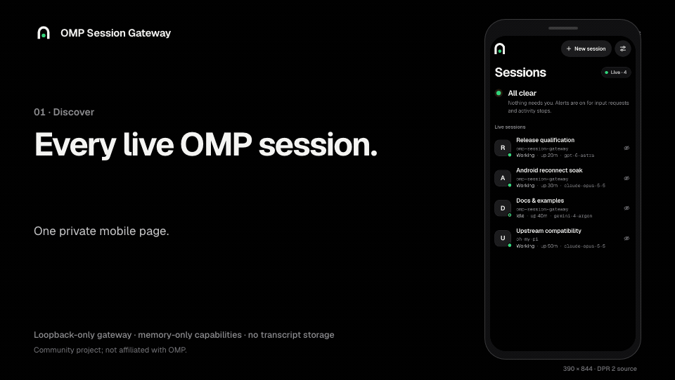
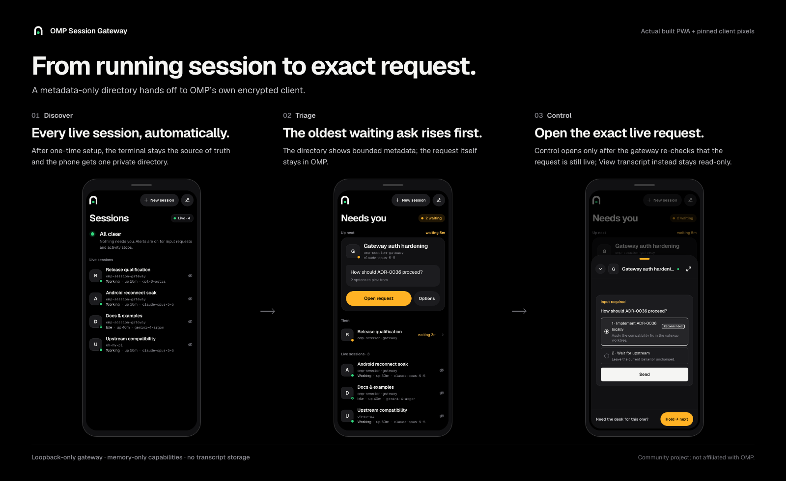
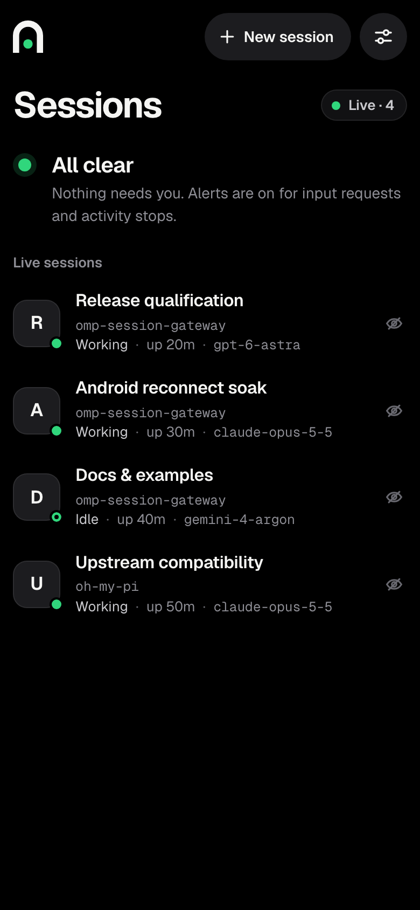
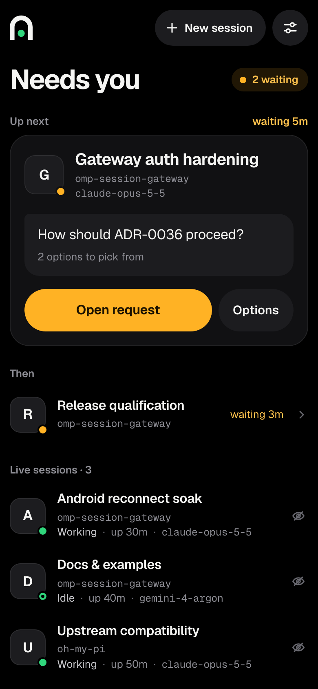
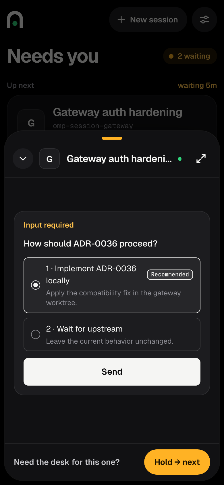
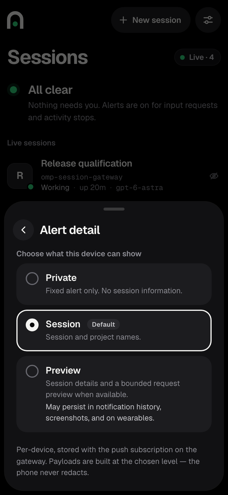

<div align="center">

<picture>
  <source media="(prefers-color-scheme: dark)" srcset="assets/logo.svg">
  <source media="(prefers-color-scheme: light)" srcset="assets/logo-light.svg">
  
</picture>

# OMP Session Gateway

**Every live OMP session. One private page, in any modern browser.**

Keep using [Oh My Pi](https://github.com/can1357/oh-my-pi) in your terminal. OMP Session Gateway lists your collaboration-enabled sessions, shows which need you, and opens OMP's own encrypted **View** or **Control** client from your phone — no QR scans or per-session link copying.



<sub>Synthetic product demo captured from the built app and pinned collaboration client (<a href="docs/media/README.md">capture provenance</a> · <a href="docs/media/omp-session-gateway-demo.mp4">MP4</a>).</sub>

**[Get started](#get-started)** · **[Docs](docs/README.md)** · **[Security](docs/SECURITY.md)** · **[Compatibility](docs/COMPATIBILITY.md)** · **[Latest release](https://github.com/carrythroughsystems/omp-session-gateway/releases/latest)**

[![CI][ci-badge]][ci]
[![Releases][release-badge]][releases]
[![License][license-badge]][license]

[ci]: https://github.com/carrythroughsystems/omp-session-gateway/actions/workflows/ci.yml
[ci-badge]: https://img.shields.io/github/actions/workflow/status/carrythroughsystems/omp-session-gateway/ci.yml?branch=main&label=CI&labelColor=111113
[releases]: https://github.com/carrythroughsystems/omp-session-gateway/releases
[release-badge]: https://img.shields.io/github/v/release/carrythroughsystems/omp-session-gateway?filter=v*&label=release&color=29292D&labelColor=111113
[license]: LICENSE
[license-badge]: https://img.shields.io/github/license/carrythroughsystems/omp-session-gateway?color=29292D&labelColor=111113

Works with stock [OMP 18.1.20+](https://github.com/can1357/oh-my-pi/releases/tag/v18.1.20) — no fork or custom build.

</div>


## How it works

<div align="center">

</div>

1. **Discover automatically.** Every collaboration-enabled `omp` process on the host appears in **OMP Sessions**, the gateway's web app, on the next 10-second discovery poll. There is no per-session command, QR code, or link to copy.
2. **The oldest request first.** When a session waits for input, **Needs you** names it and puts the oldest request at the top. The prompt itself stays in OMP.
3. **One tap to the real session.** **Open request** opens OMP's own encrypted collaboration client on that exact request in **Control**; a tap on any live session opens it read-only in **View**. The link is fetched when you tap and is never stored.

<details>
<summary>Screens</summary>

<p>
  <br>
  <sub><strong>All clear:</strong> every live session listed automatically with no per-session setup.</sub>
</p>
<p>
  <br>
  <sub><strong>Needs you:</strong> the oldest waiting request is promoted first with bounded metadata.</sub>
</p>
<p>
  <br>
  <sub><strong>Open request:</strong> one tap opens OMP's own encrypted collaboration client.</sub>
</p>

</details>

<a id="build-and-run"></a>
## Get started

You need:

- the [latest stable release](https://github.com/carrythroughsystems/omp-session-gateway/releases/latest)
- **Bun 1.4.4** at a path that stays put; the background service runs `bun` from it
- stock **OMP 18.1.20 or later**
- Tailscale on the host and on your phone: a TUN-mode client on the host, and Serve over tailnet HTTPS, **never Funnel**

### 1. Enable collaboration once in OMP

```sh
omp --version # must report at least 18.1.20
omp config set collab.autoStart control # or view for read-only sharing
```

Start participating sessions with plain `omp` after changing this setting; already-running `omp` processes do not pick it up.

### 2. Install the gateway

Download the archive and [verify it](docs/RELEASE.md#verify-a-published-build). If the host still runs v0.3.0 or earlier, [uninstall that release with its own CLI first](docs/UPGRADE_ROLLBACK.md#recover-across-the-v030-boundary). Then, from the download directory, install the gateway with the host's Tailscale HTTPS address and your Tailscale login:

```sh
tar -xf omp-session-gateway-*-bun.tar
cd omp-session-gateway-*-bun
bun apps/gateway/src/cli.js install \
  --origin https://host.example.ts.net \
  --allow you@example.com
bun apps/gateway/src/cli.js serve-guidance
```

On Windows, use the [PowerShell steps in Operations](docs/OPERATIONS.md#2-cli-and-daemon-installation): one line per command, no `\` continuations.

Run the Tailscale Serve command that `serve-guidance` prints, grant your login HTTPS access to the host in your tailnet policy ([example](examples/tailscale-policy.hujson)), then check the installation:

```sh
bun apps/gateway/src/cli.js doctor
```

`doctor` exits non-zero when a check fails; [Troubleshooting by symptom](docs/OPERATIONS.md#troubleshooting-by-symptom) covers the common causes. To run from a source checkout instead of the release archive, see [Build from source](CONTRIBUTING.md#build-from-source).

### 3. Open OMP Sessions on your phone

Open the HTTPS address on a phone signed in to Tailscale with the login you allowed, and add **OMP Sessions** to your Home Screen. The first launch walks through three short trays: **Connected**, **Background alerts**, and **View or Control**.

Setup is one-time: each new `omp` session appears within 10 seconds. [Using OMP Sessions](docs/USAGE.md) covers the app; [Installation and operations](docs/OPERATIONS.md) covers updates and service management.

## Using it

- **[The directory](docs/USAGE.md#the-directory) and [Needs you](docs/USAGE.md#needs-you)** — Live sessions are listed under **All clear**. When any session waits for input, the app switches to **Needs you** and puts the oldest request first.
- **[View and Control](docs/USAGE.md#view-and-control)** — Tap a live session to read along in **View**; tap **Open request** to answer in **Control**. You can attach photos, and a reply shows `Sending…` until OMP confirms it.
- **[Hold and hide](docs/USAGE.md#hold-and-hide)** — **Hold for desk** sets a request aside on this device and moves to the next one. **Hide** takes a session that is not waiting off this device's list.
- **[Background alerts](docs/USAGE.md#background-alerts)** — Opt in per device and choose **Private**, **Session**, or **Preview** detail. An input-request alert opens **Control**; an alert that a turn finished opens **View**.
- **[Multiple hosts](docs/USAGE.md#multiple-hosts)** — One installed app lists and opens sessions on up to eight hosts once an administrator [connects them](docs/OPERATIONS.md#7-multiple-hosts).
- **[Alerts from other hosts](docs/USAGE.md#alerts-from-other-hosts)** — The home gateway, the one that serves the installed app, sends alerts for each remote host you switch on, after [administrator setup](docs/OPERATIONS.md#8-alerts-from-other-hosts).
- **[Dictation](docs/USAGE.md#dictation-and-speech-input)** — Dictate with your keyboard's microphone key, or with an optional in-page recognizer that an administrator enables. **Use text** fills the composer and never sends.
- **[New sessions](docs/USAGE.md#start-a-new-session)** — Where an administrator has [enabled it](docs/OPERATIONS.md#9-tern-session-creation), start a new `omp` session in Tern from approved project, working-copy, and profile choices. An optional **First task** draft is placed in the composer and never sent for you.
- **Light and dark** — The app follows your device's appearance. Color marks state only: green for live, amber for waiting on you, red for access denied.

<div align="center">
<br>
<sub>Per-device notification detail in the <strong>Alert detail</strong> tray, opened from the <strong>Background alerts</strong> tray. Full guide: <a href="docs/USAGE.md">Using OMP Sessions</a>.</sub>
</div>

## Private by design

- **Loopback-only daemon** — `omp-gatewayd` binds to `127.0.0.1` and optionally `::1`, never to a network interface.
- **Tailscale Serve and an exact login allowlist** — Requests arrive only over tailnet HTTPS through TUN-mode Tailscale Serve, from a Tailscale login on your allowlist. Funnel is never enabled.
- **Links fetched per tap and kept in memory** — A View or Control link is a bearer secret. It is fetched from OMP only when you tap, handed to the client once, and never stored, logged, or cached.
- **Metadata-only directory and alerts** — Session lists, live events, and alerts carry bounded session metadata only, never collaboration links or prompts.
- **No transcript storage, telemetry, or third-party assets** — OMP's own browser client connects through OMP's encrypted relay. The gateway stores no transcripts, sends no telemetry, and loads no external scripts.
- **Stale sessions cannot be opened** — Every launch checks that the session is still the one you tapped. A replaced or exited session fails closed instead of opening something newer.
- **Other hosts are reached directly** — With several hosts, your browser talks to each exact trusted origin itself; no gateway proxies another. Alerts from other hosts carry identifiers only, never titles, paths, previews, or links.
- **Session creation is opt-in and bounded** — Starting a session uses only the project, working-copy, and profile choices an administrator approved, and an uncertain start is never retried automatically.

Read the [security model](docs/SECURITY.md) or [report a vulnerability privately](SECURITY.md).

## Supported platforms

| Surface | Qualified on real hardware (latest release) |
|---|---|
| Linux host | Debian 13 x86-64 |
| macOS host | macOS 27 arm64 (Virtualization.framework guest, not bare metal) |
| Windows host | Windows Server 2025 x86-64 (build 26100), started at interactive logon, Administrator or standard account |
| Android | A physical Pixel (Chrome on Android), including background alerts; a cloud Samsung Galaxy |
| iPhone & iPad | A cloud iPhone and iPad on Safari; iPhone background alerts in the Home Screen app (not the lock screen) |
| Desktop Chrome, Edge, Firefox, Safari | CI only (Chromium, Firefox, and WebKit engines) |
| Exact qualified OMP | `v18.18.0` ([`b5a6b2f7e5`](https://github.com/can1357/oh-my-pi/commit/b5a6b2f7e5b6606b6562e678ead83f21738f34a0)); Bun `1.4.4` |

Every row is **supported**: tested in CI on each change, bug reports accepted. **Qualified** names the exact hardware, OS, and browser versions verified for the latest release — see [Platforms and browsers](docs/COMPATIBILITY.md#platforms-and-browsers) and [Current claim](docs/COMPATIBILITY.md#current-claim).

[TestingBot](https://testingbot.com) supports this project with free real-device testing through its open-source program.

This project is tested with BrowserStack.

### Known limits

- **Tailscale TUN mode is required.** Userspace networking hides peer identities behind loopback, so the gateway refuses requests. If `doctor` reports `loopbackTrustSound: false`, switch Tailscale to TUN mode rather than bypassing the check.
- **Tailnet only.** Expose the gateway only through Tailscale Serve over tailnet HTTPS. Never enable Tailscale Funnel; there is no supported public-Internet path.
- **Default relay only.** Sessions connect through OMP's default end-to-end-encrypted relay. Self-hosted and proxied relays are unsupported.
- **Starts at login on macOS and Windows.** The service starts when you sign in, not at unattended boot. After a reboot, sign in on the host before opening sessions from your phone.
- **Single-user workstation only.** Local accounts on the same machine can reach loopback directly. Deploy on a workstation you control, not a shared host.
- **Android radio changes can stall Chrome.** Switching between Wi-Fi and cellular can stall Chrome's network stack ([#65](https://github.com/carrythroughsystems/omp-session-gateway/issues/65)). The app retries and, after 45 seconds of visible failure, offers **Troubleshooting** with the steps to force-stop and reopen the browser.
- **Preview detail shows what Session shows.** Stock OMP does not publish a prompt preview, so both levels send the session title and folder name. Choose **Private** to keep session names off your lock screen.
- **Alerts from other hosts depend on the home gateway.** It sends every alert, so it has to stay awake and reachable. A remote host's alert shows only the host label and a six-character session suffix.
- **Starting sessions in Tern has run end to end only on Apple silicon macOS.** Linux and Windows hosts are covered by unit tests only.

## Documentation

- [Using OMP Sessions](docs/USAGE.md) — install on your phone, triage requests, open **View** and **Control**, use multiple hosts and alerts, and start sessions
- [Installation and operations](docs/OPERATIONS.md) — host setup, Tailscale Serve, access policy, optional multi-host and Tern configuration, updates, and `doctor`
- [Upgrade and rollback](docs/UPGRADE_ROLLBACK.md) — update in place, roll back to a previous installed version, and restore saved settings
- [Compatibility](docs/COMPATIBILITY.md) — supported platforms, hardware-qualified combinations, and status definitions
- [Security model](docs/SECURITY.md) — threat model, trust boundaries, and capability-handling invariants
- [Documentation index](docs/README.md) — architecture, wire contracts, package guides, qualification runbooks, and release records

<a id="how-it-compares"></a>

## Alternatives

Primary READMEs and package metadata checked 2026-10-29; see the dated sources in the full comparison below.

- **Keep work in running `omp` terminals** — **OMP Session Gateway** lists live terminal sessions and opens OMP's encrypted View or Control client from your phone.
- **Agent web chat or remote terminal over tunnels** — [oh-my-portal](https://github.com/gosuda/oh-my-portal) provides skills, RPC, and terminal access over Portal tunnels.
- **Browser workspace for other coding CLIs** — [CloudCLI (`claudecodeui`)](https://github.com/siteboon/claudecodeui) targets Claude Code, Cursor CLI, and Codex; [pi-agent-dashboard](https://github.com/BlackBeltTechnology/pi-agent-dashboard) targets `pi`. See the [full comparison](https://carrythroughsystems.github.io/omp-session-gateway/compare/).

## Contributing

See [CONTRIBUTING.md](CONTRIBUTING.md) for development workflow and source builds, [docs/BACKLOG.md](docs/BACKLOG.md) for open follow-ups, and [SECURITY.md](SECURITY.md) to report a vulnerability privately.

OMP Session Gateway has no telemetry, analytics, or hosted control plane. This is a community project and is not affiliated with or endorsed by the Oh My Pi maintainers.

## License

MIT. See [LICENSE](LICENSE).
