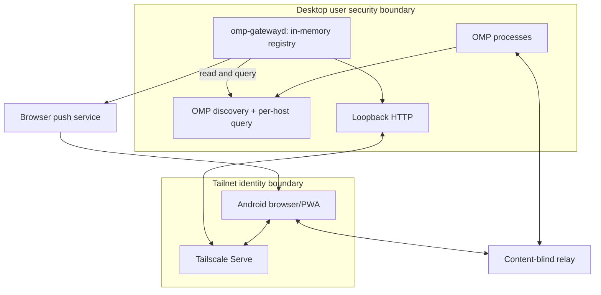

# Architecture

## 1. Components

### 1.1 Mainline OMP discovery reader

Stock mainline OMP `>= 18.1.20` owns its collaboration controller and per-host local registry.
[PR #11908](https://github.com/can1357/oh-my-pi/pull/11908), merge `4999b98bd5`, ships in [OMP v18.1.20](https://github.com/can1357/oh-my-pi/releases/tag/v18.1.20). No fork, custom OMP build, or gateway-specific OMP plugin is required.
The gateway remains a separate installation: enable `collab.autoStart` once, then start plain
`omp`. Bun 1.4.0 and TUN-mode Tailscale Serve remain deployment prerequisites; see
[OMP_INTEGRATION.md](OMP_INTEGRATION.md).

`OmpHostReader` reads discovery entries under `~/.omp/run/collab-hosts` (or the configured
`omp.discoveryDir`) and queries each entry’s published `endpoint` with its per-host token.
OMP may relocate a long socket path; deriving a socket name from the JSON filename is incorrect.
The gateway never writes, renames, or unlinks anything in the discovery directory.

Snapshot queries return metadata only. OMP owns publication and cleanup, independently of the
gateway. The file shape and one-request-per-connection wire contract are in [PROTOCOL.md](PROTOCOL.md).

### 1.2 Host poller and launch broker

`startHostPoller` coalesces concurrent polls, reads host snapshots, and reconciles the metadata-only
`SessionRegistry`. `registry.heartbeatSeconds` is the poll interval (default 10 seconds), not a
publisher heartbeat. Hosts absent from discovery or conclusively dead are removed; transient query
failures retain an existing card until `registry.ttlSeconds` (default 35 seconds) expires. Only
`ENOENT`/`ECONNREFUSED` proves a queried host finished; a timeout, `EMFILE`, `EACCES`, or wire
error such as `snapshot_unavailable` must not retire it immediately.

`OmpLaunchResolver` is the launch broker. After the HTTP authorization checks, it verifies the
observed generation, requested access, and optional attention request identity; queries OMP for a
`link` for that exact generation and access; and revalidates before returning a capability.
`mode_unavailable` refuses a role no longer shared.

The gateway fetches capabilities **only per explicit launch**. It never stores or caches them,
including in the registry: their gateway lifetime is confined to the query and no-store launch
response. This is strictly narrower than the fork-era in-memory secret store, which retained links
for the lifetime of a published session.

The opt-in creation service (`apps/gateway/src/tern-creation.ts`) subscribes to stripped poller
observations in `apps/gateway/src/omp-registry.ts` through `subscribeObservations` and requests
`refreshForAdoption` rounds started after the request, not merely an older in-flight poll.
Reconciliation precedes observation publication. Concurrent fresh requests coalesce into one
following round without overlapping reads; cancellation removes
only the caller's wait. Observations contain binding/timing/Control metadata, never discovery
tokens, endpoints, capabilities, full cwd, or Tern metadata. Ordinary polling, TTLs, and launch
authorization remain unchanged.

### 1.3 `omp-gatewayd`

A per-user daemon is the sole aggregator and remote authorization point.

Responsibilities:

- read OMP discovery and query per-host endpoints;
- maintain an in-memory metadata registry with process/session generations and freshness TTLs;
- expose a loopback-only HTTP server and static PWA;
- authorize requests using Tailscale Serve identity plus an application allowlist;
- return a single capability only after an explicit View or Control action;
- stream metadata-only updates with SSE;
- start at desktop login and recover cleanly from restart;
- embed or serve a pinned build/integration of OMP's existing `collab-web` client;
- persist private VAPID/subscription material separately from the memory-only session registry and send metadata-only Web Push attention/resolution envelopes;
- provide `install`, `status`, `doctor`, token rotation, and `uninstall` through `omp-gateway`.
- serve `GET /api/v1/client-config` (same-origin only, `no-store`) and, when `http.trustedDashboardOrigins` is configured, admit browser-direct CORS requests from those exact origins only on `GET /api/v1/sessions`, `POST /api/v1/sessions/:instanceId/launch`, `GET /api/v1/session-creation-options`, `POST /api/v1/session-creations`, `GET /api/v1/session-creations/:operationId` (exact lowercase UUIDv4), and their `OPTIONS` preflights (`apps/gateway/src/http-policy.ts`, [ADR-036](DECISIONS.md#adr-036--federated-dashboard-origins-through-browser-direct-cors)) without server-side proxying or fleet push.
- when explicitly configured, create a new interactive OMP process through the bounded Tern CLI
  boundary and adopt it through OMP-native discovery, never through a terminal discovery adapter.

The registry is intentionally empty after daemon restart. The next host poll repopulates it; no capability store exists.

`apps/gateway/src/cli.ts:runServe()` owns `SessionCreationService`, the poller, HTTP server, and
shutdown, just as it owns `PushService`; `service.ts` remains OS-service installation code.
`tern-creation.ts` owns serialized admission, a private capability-free
`<stateDir>/session-creations.json` ledger, state transitions, and adoption. `tern-cli.ts` owns
only bounded subprocesses, lossless numeric-ID decoding, metadata projection, and child cleanup.
Intent and every checkpoint are durable before exposure or dependent effects. Restart classifies
in-flight operations conservatively without resuming or re-spawning; shutdown never closes Tern
tabs, kills OMP, or modifies OMP discovery. See [ADR-043](DECISIONS.md#adr-043--opt-in-tern-creation-with-omp-native-adoption).

### 1.4 OMP Sessions PWA

The PWA is a deliberately small session directory and launcher.

Each card may show only non-secret metadata:

- friendly title;
- repository or directory basename, with full paths disabled by default;
- model label when configured;
- process start and last-seen time;
- health/streaming state if available without transcript data;
- boolean response-required state, rendered as **Needs attention**, with an opaque request identity
  and receipt timestamp but no prompt content or answer data;
- **View** for ordinary read-only launches and **Open request** for attention requiring Control;
- **Hold for desk** for exact-ask local queue routing; and
- **Hide** for reversible device-local hiding of non-attention rows, presented as a
  compact per-row control with an explicit accessible label.

A directory with zero live sessions shows the `collab.autoStart` empty-state guidance instead of a
zero-count summary. Device-scoped preferences — the background-alert toggle, notification detail,
and build identity — live in the Background alerts tray and its Alert detail child behind a persistent masthead control; the `All
clear` summary claims "You'll get pinged" only while alerts are enabled and otherwise offers the
Settings path.

The PWA never prefetches capabilities. On bootstrap it fetches same-origin `GET /api/v1/client-config` (`cache: "no-store"`, `credentials: "same-origin"`, `redirect: "error"`, 4-second timeout, bounded to `MAX_CLIENT_CONFIG_BYTES`). A `404` response from an older gateway falls back to local-only operation with browser speech recognition disabled and no error banner. A failed or invalid configuration keeps the local directory usable and creates no remote sources. The banner owns `Fleet configuration unavailable` with **Try again** only while the local list is available; a local transport outage replaces that story, never adds a fleet row. Reconnect retries failed bootstrap after a successful local snapshot, coalescing concurrent recovery attempts; successful configuration clears the banner.

For the local source (`id: "local"`), the PWA receives metadata from `GET /api/v1/sessions` and `GET /api/v1/events`. When `fleet.targets` (up to 7 remote sources, 8 total with `local`) is configured, the PWA polls each remote target's `GET <origin>/api/v1/sessions` directly from the browser (`mode: "cors"`, `credentials: "omit"`, `cache: "no-store"`, `redirect: "error"`, 5-second timeout, 8 MiB response bound) immediately on visible start and every 10 seconds while visible, with at most one request in flight per source and jittered exponential failure backoff (1 s to 30 s). It never opens a remote `EventSource` or fetches remote `client-config`, `health`, or `push` routes. Each session is keyed in page memory by `SourceKey = id + "\0" + origin` and `SessionRef = { sourceKey, instanceId, generation, requestId? }`; the composite source key is never concatenated into an OMP `instanceId` or sent over the network.

A native `<select>` labeled **Host** filters the directory across **All hosts**, the local host label, and configured `fleet.targets` in configuration order; filter state lives in volatile page/history state only and never changes background polling. Every session row, hero card, held row, and active collaboration shell bar displays its host label. **All clear** and **No live sessions** require fresh snapshots for every source in scope. Otherwise, coverage aggregates counts, accessible names say **Listed**, and quiet checks are not host failures. Only independent failed remote sources get named rows; the banner owns device/local-gateway connectivity. Under **All hosts**, waiting sessions follow first observation of each exact ask (`observed waiting order`, tie-broken by `sourceKey` then `instanceId`); a selected host keeps `ask.since` FIFO. A readable remote `403` clears rows, marks the source forbidden, cancels its launches, stops automatic polling until a foreground/online recheck, and disposes its active shell; it offers no **Retry**. Other failures retain disabled stale rows for 35 seconds, then expire them while retaining the successful **List as of** clock and `Host unavailable` row. A retained empty observation says **No sessions as of** that clock, not that the host was never checked.

`availability.ts` is the pure eight-state presentation model: loading, fresh, refreshing, stale,
expired, unavailable, forbidden and withdrawn. An authorization-withdrawn observation cannot
certify an empty list or reuse its old clock, including during a later offline retry; only a
fresh authorized snapshot restores that observation. `fleet.ts` owns transport/retention; `app.ts` adapts its local
and remote observations to the model and writes every banner through one single-child writer.
Offline marks remotes stale without hiding them or stopping their retry chain; the grace deadline
still runs. Every reconnect restores visibility idempotently, so recovery never requires an
`online` event. Hiding/freezing still aborts without inventing a failure.
A pending retry preserves the named local fault, even before the first successful snapshot.
Remote launch denial uses its forbidden host row without replacing an independent local banner.
Bootstrap recovery updates the existing local source's label in place; its origin-bound object
identity remains stable for accepted creation intents and their exact Ready handoff.
Visible guidance timing is separate from the named local fault: hiding, expiry messages, and
remote mounts cannot clear that fault or cancel its retry chain. Only a successful local
observation or a replacement named local fault changes its ownership.
Local list, launch, creation and embedded-probe denials share one withdrawal transition: clear
metadata and clock, invalidate the event epoch, close the stream, cancel local work, and require
a fresh authorized snapshot. Late pre-denial upserts, keepalives and errors cannot resurrect it.
Remote launch errors remain source-scoped, including 404/409 and transport failures. Their host
notice lasts until that source is checked successfully or a launch succeeds; Refresh host never
replays a capability request. Observation-aware empty copy also covers All hosts and single-host views.
Denying, failing, discarding or programmatically cancelling an unmounted request preview restores
and consumes its directory snapshot without starting another fetch or reverting a newer host selection.
Pagehide is the exception: cancellation keeps the snapshot and metadata-only resume intent together
until persisted pageshow revalidates and relaunches. Local authorization withdrawal does not skip
remote refresh during restoration, and remote triage gates on its own source freshness, not local
directory readiness. Cross-host Next-ask failures retain the target's notice across predecessor
health updates; expired targets still refresh, and Sessions returns to list-only recovery.
Target-owned triage arbitrates all predecessor writers, including Hold reconciliation and short
connection interruptions. Explicit dismissal also invalidates a pending expired-target feedback update.
Mounted action failures use this owner whether the target is local or remote. Local success paths release
the owner just like remote observations; a successful expiry refresh never recreates a failed host row.
Pending launches, not `answerShown`, suppress Hold reconciliation, so dismissal can restore Hold immediately.
Launch acceptance revalidates current View/Control eligibility as well as source, generation and request.
The accepted shell receives that revalidated metadata, including its current title and Control affordance.
Every new launch intent advances the selection epoch, so a failed newer intent still supersedes an older
resume. Creation establishes that epoch when its wizard opens; its launch handoff continues the same intent.
Selected-source empty rendering also uses its own observation, with retained empty clocks ahead
of neutral checking progress.
Availability descriptors retain the exact successful observation instant separately from formatted time;
All-hosts empty rendering compares those instants before claiming a shared clock.

Couch triage is a device-local presentation layer over authoritative metadata. **Hold for desk** and **Hide** persist under `localStorage` keys `omp.sessions.held-asks.v2` and `omp.sessions.dismissed.v2`, adding `sourceId` and `sourceOrigin` to the bounded `(instanceId, requestId, heldAt)` and `(instanceId, generation, dismissedAt)` records (100 items / 512,000 bytes max). Existing v1 keys migrate to the local source and are removed only after the v2 write succeeds; records whose source is no longer configured or whose `sourceId` now maps to a different origin are dropped at bootstrap. Holding skips the ask in this device's rotation without clearing gateway attention, reducing the home pending count or app badge, or affecting another device, and Hold on a remote source never enumerates or closes home notifications even when `instanceId` collides. Active-shell Hold commits only after the next launch succeeds; a launch failure leaves the current ask in rotation and keeps its collaboration shell mounted while offering source-appropriate recovery.

Authoritative snapshots and upserts remove a held record when its exact ask changes or clears, and remove a dismissal when the session disappears, its generation changes, or it needs attention. Transport failures do not erase either record. Optional `busy` distinguishes sampled activity from idle/unknown, not successful completion. The PWA must not invent a Completed state or label local dismissal as Close or Exit. These bounded records contain no title, path, model, prompt, answer, transcript, or collaboration capability.
An explicit Background alerts tray action enables background Web Push. Permission is never requested on load.
The gateway sends strict Push v2 attention/clear and activity-stop envelopes with bounded identity and a
bounded pending count. Private detail uses a fixed title with no body; Session (the default) adds
bounded session/project labels. Preview falls back to Session because stock OMP supplies no ask
preview. Visible text may persist in notification history, screenshots, or wearables. A tap never
navigates an open window: the worker focuses the most recently focused one and posts it the
notification's metadata-only data, and the page revalidates the exact current ask or generation
in place, keeping a collaboration already open at the tapped authority. With no open window, or
none that accepts within three seconds, it opens `/collab/:instanceId?request=:requestId`, which
the app synchronously scrubs before the same revalidation (ADR-017 amendment). Valid taps use the
ordinary generation-bound, no-store, in-memory launch flow; stale taps never launch. Background
delivery remains best effort; see [COMPATIBILITY.md](COMPATIBILITY.md#platforms-and-browsers) for the qualified Android WebAPK and iPhone Home Screen app scope.

The registry alone detects known busy-to-idle edges on a continuing identity/generation. Retained
polls remove only activity knowledge without extending TTL. Its private stop event shares the
ordered dispatch queue but is never sent as a browser SSE event. A record-local revision marker
invalidates stale queued delivery across busy, unknown, or identity transitions. Neither a previous
nor current waiting sample may produce a stop. Stop taps use the exact instance/generation route
and open View after fresh metadata; they never acquire Control. The shared per-instance
notification tag and displayed-attention priority are specified in [ATTENTION_SPEC.md](ATTENTION_SPEC.md).

PWA upgrades activate immediately after the new content-hashed shell is cached. The shell includes
the pinned collaboration-client module and stylesheet, and an idle directory warms the module
import so a launch pays only for its capability request and relay connect; launch-time loading
remains the fallback. Session-title Private Use Area symbols use a first-party-served Symbols Nerd
Font Mono subset, split into content-hashed WOFF2 chunks by `unicode-range`; chunks are excluded
from install precaching, downloaded only when a rendered glyph needs them, and served cache-first
from the shell cache after their first successful fetch. Activation retires prior shell caches and
claims clients but never navigates one: Chromium reports a client's creation URL, not the route the page later reached through the
history API, so the worker cannot tell an idle directory from a pending launch or a live `/client/`
collaboration (ADR-018 amendment). The page observes the controller change and reloads itself after
one second only while no launch is pending, no routed notification awaits its snapshot, and no
collaboration client is mounted. Otherwise the update applies when a failed launch returns to the
directory or the user leaves collaboration. The no-store `/update/` bootstrap, which the new
document synchronously scrubs to `/`, remains only for activations by earlier workers.

### 1.5 Existing OMP collaboration client

Reuse a pinned OMP `packages/collab-web` revision. Do not independently implement the transcript, tool cards, subagent controls, relay protocol, or cryptography.

The embedded source and npm wire pin are `v18.12.6`, independently of the `v18.12.5` host baseline.
The client vendors only the pure TypeScript pi-utils marked fork and math/list grammar, avoiding
the pi-utils/native package closure. Upstream coalesces streaming commits per animation frame
and parses only unfrozen Markdown tails; gateway windowing and memory-only bootstrap remain.

Preferred integration:

1. expose a small upstreamable client bootstrap such as `startWithCapability(capability)` or a component prop;
2. render or mount the client from the same PWA origin;
3. keep the capability in JavaScript memory only;
4. dispose of references when leaving the session;
5. return to the directory on reload because the capability is intentionally not recoverable.

In a writable Control session, the same pinned client may collect up to four photos through the
Photo action's explicit source panel. **Take photo** uses a dedicated file input with
`capture="environment"`; **Choose existing** uses a separate image input without `capture` so
Android never has to infer camera-versus-library intent from one control. It rejects source
dimensions above an 8,192px edge or 20 megapixels, then decodes and canvas-re-encodes JPEG, PNG, or
WebP input in volatile browser memory, stripping
EXIF/location metadata while bounding each normalized JPEG to a 2,048px edge and 1 MiB. The
composer passes an optional note plus those images through OMP's existing encrypted v3
`prompt.images` frame directly to the host, then retains the draft until the host echoes the
corresponding transcript entry. No gateway HTTP endpoint,
registry record, service-worker route, URL, browser-storage record, or new relay protocol is added.
The host and model provider receive the normalized prompt exactly as they would an image attached
locally in OMP; ordinary OMP transcript/provider retention therefore still applies.

`startCollabWithCapability` also accepts `probeGateway` and `browserRecognitionEnabled` on `CollabEmbedOptions`:

- **`probeGateway`:** replaces the default same-origin `GET /api/v1/health` recovery probe with a source-bound, coalesced `GET <source>/api/v1/sessions` check that resolves `"healthy"` only when the body parses as a valid session list, `"forbidden"` on a readable `403`, and `"unavailable"` on any other failure. On `"forbidden"`, `gatewayHealth.state` transitions to `"forbidden"` with no relay refresh and no automatic probe retry (a later visibility or online transition may probe once more). Non-embedded callers that omit `probeGateway` keep the default same-origin `/api/v1/health` probe.
- **`browserRecognitionEnabled`:** reflects the hosting document's `speech.browserRecognition` setting ([ADR-037](DECISIONS.md#adr-037--speech-input-keyboard-dictation-baseline-and-opt-in-browser-speech-recognition)). OS keyboard dictation works in the composer `<textarea>` under the default `Permissions-Policy: microphone=()`. When `speech.browserRecognition: true` is configured on the home gateway, document HTML responses set `Permissions-Policy: microphone=(self)` and the composer enables an opt-in Web Speech (`SpeechRecognition` / `webkitSpeechRecognition`) microphone control in writable **Control** sessions only. Recognized text stays in a reviewable draft buffer until the user taps **Use text**, which inserts into the composer without sending; **Send** remains a separate explicit action.
A same-origin child window plus `MessageChannel` is acceptable only when the browser preserves a distinct exact-origin opener: open `/client/` synchronously during the tap, fetch the capability in the opener, transfer it with a same-origin `postMessage`, and never put it into a URL or DOM attribute. Installed Android PWA launch must use the preferred same-document mount because Chrome may reuse the standalone window without an opener.

The pinned client uses the in-memory bootstrap. Do not introduce a fragment-based compatibility
path: fragments can remain in browser history before replacement and leak through screenshots or
copied URLs. Reload intentionally returns to the metadata directory.

### 1.6 Relay

**v1:** use OMP's existing encrypted collaboration relay. OMP seals collaboration payloads before the socket, and the gateway does not need to proxy WebSockets.

**Optional hardened mode:** self-host OMP's content-blind relay on the desktop or tailnet. Keep it a separate opt-in deployment and validate long-lived WebSocket behavior, Android sleep/resume, network changes, and reconnects through the exact production proxy path before calling it supported.

## 2. Runtime flow

### 2.1 Desktop login

1. The OS starts `omp-gatewayd` as the current user.
2. The daemon atomically creates or reads its private readiness token for CLI readiness proofs.
3. It starts polling OMP’s discovery directory; no gateway publisher endpoint is created.
4. It binds HTTP to loopback, for example `127.0.0.1:4317`.
5. A persistent Tailscale Serve mapping exposes that loopback server privately over tailnet HTTPS.

### 2.2 OMP process start

1. Interactive OMP finishes creating the active session/context.
2. If `collab.autoStart` is `view` or `control`, OMP’s controller starts collaboration.
3. OMP publishes its discovery file and owner-only per-host query endpoint.
4. The next gateway poll fetches a metadata snapshot and reconciles the process card.
5. A changed registry revision emits metadata-only SSE, and the phone renders the card.

OMP’s snapshot supplies the boolean `inputRequired`, not prompt or response content. Each accepted
false-to-true transition creates one opaque in-memory attention identity and receipt timestamp.
Repeated true observations preserve that identity; false, removal, expiry, and generation
replacement destroy it. The browser receives the boolean plus `ask.requestId` and `ask.since`;
OMP remains unaware of this browser-routing metadata.

### 2.3 Background attention push

1. The user explicitly grants notification permission and subscribes through
   `POST /api/v1/push/subscription`, choosing `private`, `session`, or `preview` detail.
2. The gateway persists only the VAPID key pair, browser endpoint/keys, authenticated identity, and
   detail choice in a private state file.
3. A Control-capable attention transition builds an encrypted `attention` message at the selected
   detail level; clear/removal builds `clear`. Neither contains a capability.
4. The browser push service wakes the installed PWA's service worker even when no page is open.
5. The worker tags one notification per instance, updates the app badge from the bounded pending
   count, and closes that tag on `clear`.
6. Tapping opens `/collab/:instanceId?request=:requestId`; the app fetches current authenticated
   metadata and launches Control only when the exact request identity remains actionable.

### 2.4 View or Control launch

1. The user taps **View** or **Control**.
2. The shipped same-document client tracks the pending launch in page memory before loading its assets and requesting a capability. Full-screen View changes the URL to `/client/` at mount; Open request mounts inside the native tray and only Expand replaces the route with `/client/`, reparenting the same shell without remounting the client. Because service-worker activation claims clients without navigating them and the page defers its `controllerchange` reload while a launch, routed notification, or collaboration is active, a worker upgrade never interrupts an in-flight launch.
3. The PWA performs a same-origin `POST /api/v1/sessions/:instanceId/launch` with the observed generation and desired mode.
4. The gateway verifies Tailscale identity, application allowlist, Origin, fetch metadata, content type, rate limits, generation, freshness, and mode availability.
5. The launch broker queries OMP for the exact generation and role, revalidates current state, and
   returns exactly one capability in the no-store response without retaining it.
6. The PWA passes the capability directly to the pinned collab client's in-memory bootstrap, optionally through a same-origin `MessageChannel`.
7. The client connects directly to the relay encoded by OMP's parser.
8. Leaving the client drops capability references and returns to the metadata directory. Reload does not reconnect automatically.

### 2.5 Session switch, resume, or branch

OMP owns host replacement and generation changes. The gateway observes replacement snapshots and
updates the existing process card. A launch carries the generation seen by the browser; OMP’s
`link` operation rejects `stale_generation`, and the broker revalidates after querying. An old
card never silently receives a replacement capability.

### 2.6 Crash and stale cleanup

The daemon records successful observation time using a monotonic clock. A missing discovery entry
or a host query failing with `ENOENT`/`ECONNREFUSED` removes the card. Other query failures retain
an existing card until its TTL expires; the default is a 10-second poll interval and 35-second TTL.
A connection closing after a response is normal: OMP serves one request per connection.

Removal drops metadata before emitting SSE. There is no capability map to clear and no OMP-owned
file or socket for the gateway to delete.

## 3. Trust boundaries

A malicious process running as the same desktop OS user is outside the intended threat boundary; it can generally read the user's files or interfere with OMP directly. OS permissions and per-host query tokens still reduce accidents and cross-user access but are not a sandbox against same-user malware.

A compromised or unlocked phone with valid tailnet identity is also capable of requesting sessions
until the device is revoked. WebAuthn user verification is proposed in ADR-008 and not implemented;
it is not an additional Control gate operators can rely on today.

### Test-only Percy flow

The advisory visual lane is outside the runtime architecture:

`built dashboard + pinned client → loopback synthetic fixture + in-page relay stub → Chromium at
each source viewport → installed @percy/dom serialization → exact-material/capability/identifier
guards → Percy SDK → host-restricted, JavaScript-disabled discovery → advisory visual build`.

The shared deterministic fixture also supplies README capture without changing its default
content or ordering. Local visual validation checks all 21 state/project pairs and source/serialized geometry
without starting Percy or passing credentials. Upload mode rechecks the exact SDK POST, requires
a healthy session, all submissions and finalization, and never falls back. No live OMP, real
transcript, production gateway, capability canary or third-party runtime asset belongs in this
flow. Synthetic authority stays in source-context memory; serialized HTML/resources fail if it
appears. Before uploading, a native-Node testing host runs the same 21 cases without a real token
or vendor effects. A private pipe supplies a shared ephemeral synthetic authority; the retained
fixture guard and both scanners check the exact redacted non-`ci` log candidate and reject a
planted SDK-log canary. Percy uploads those redacted CLI logs with builds; the separate CI-log
upload is disabled. These renders are not functional browser tests or signed-candidate qualification.
See [BrowserStack](BROWSERSTACK.md) and ADR-035 for vendor-role and access policy.

## Qualification attempt ownership

The stable orchestrator retains schema-3 receipts and existing lane owners rather than introducing
a workflow engine. New driver-bound executions identify the exact candidate, predecessor,
orchestrator, policy, retained Mac and attempt. A completed attempt's job and exact receipt snapshot
are immutable; only the candidate's working receipt advances. Consuming a retry removes the old
failure authorization durably before admission or setup. Passed product proofs remain unchanged,
while failed resource-owning lanes start on fresh epochs after current cleanup proof.

Consumer failure does not cancel healthy siblings. The shared OMP host and relay tunnel live until
their consumers settle; the tunnel stops before the independent publication lifecycle runs.
Publication failure has a terminal timestamp, never an invented pass. Every normally returned
campaign failure finalizes all started lanes and the campaign. Hard process death or failed storage
remains an interrupted attempt, not authority to relaunch.

Execution cancellation carries a monotonic deadline to owned reads, subprocesses and waits. The
owner aborts and awaits termination before cleanup; no timed-out promise is abandoned. Cleanup
serializes per resource owner, not globally: Pixel restoration stays under its lease, Windows
destruction does not queue behind unrelated Pixel work, and retained-Mac destructive cleanup waits
for Mac consumers and their fixture restoration. A poisoned Pixel refuses subsequent work with
collateral references to its originating failures.

Read-only admission is distinct from effectful rig readiness. After lease acquisition and verified
candidate/predecessor bytes, readiness stages a disposable candidate/stock-OMP fixture, measures
the real push path, and restores it before any full matrix fan-out. Its private receipt epoch owns
the Pixel baseline sidecar; structured observations contain only bounded numbers and booleans.
Manual attempt-zero readiness is diagnostic evidence, not a synthesized policy binding or automatic
retry authorization.

## 4. Why not process scanning or terminal automation?

Process enumeration can find PIDs but cannot safely attach OMP's browser collaboration protocol to an existing interactive context or recover a capability without reading process memory. Simulated keystrokes, terminal scraping, QR decoding, and clipboard monitoring are fragile and create additional secret channels.

Mainline OMP exposes the supported discovery/query surface needed here. Consume it rather than
private deep imports, process inspection, or a second collaboration controller.

The same discovery rule applies to Tern ([ADR-038](DECISIONS.md#adr-038--tern-is-an-execution-environment-not-an-integration), narrowly amended by [ADR-043](DECISIONS.md#adr-043--opt-in-tern-creation-with-omp-native-adoption)): an interactive `omp` process in a Tern pane publishes through stock OMP's local registry. The sole opt-in exception starts a new tab from administrator-approved `argv` and canonical working-copy choices, then uses `tern inspect --json` metadata for exact local block/pane and `omp_session_file` basename correlation. It never reads session-file contents, `tsp.ts` frames, or terminal content; it never injects keystrokes, focuses, or attaches to a pane. Tern IDs never become session identity, no general control surface is exposed, and a `ready` binding still requires ordinary generation-bound Control authorization.

## 5. Availability behavior

- Gateway unavailable: OMP continues normally and its discovery publication remains independent. The
  visible client measures the same-origin path with adaptive RTT timeouts and identifies a sustained
  outage as `Gateway unavailable` without exposing session data.
- Relay unavailable: cards remain visible. Passive host frames and optional encrypted idle probes
  measure the browser-to-host path; two missed probes replace the socket, each connection handshake
  is bounded to ten seconds, and sustained failure is identified as `Relay unavailable` without
  exposing the capability.
- Tailscale unavailable on the phone: there is no public fallback.
- Desktop asleep or offline: a loaded shell retains the last authenticated metadata in volatile
  memory, marks it stale with a freshness timestamp, and retries. Authorization denial clears it;
  metadata is never an offline capability or a substitute for launch authorization.
- Dashboard SSE silence: after 12 seconds the PWA closes the half-open stream and retries snapshots
  without clearing last-known cards. Current request timeouts and retry bounds are documented in
  [PROTOCOL.md](PROTOCOL.md#7-revisions-and-races).
- Collaboration client radio transition: browser lifecycle/network signals trigger measurement rather
  than declaring health. Hidden pages cancel relay probes. Foreground gateway recovery requires two
  successful probes and replaces a potentially stale relay socket after the first success.
- Terminal collaboration state: client recovery timers/listeners stop immediately; the ended status
  and return action remain stable and receive no later path-health publications.
- Gateway restart: it starts empty; polling discovers already-published mainline OMP hosts without
  any OMP reconnect or per-session command. Restart a fork-era OMP process under mainline at cutover.
- OMP crash: missing discovery, definitive endpoint failure, or TTL expiry removes the card.
- Browser reload: returns to the directory; capability persistence is intentionally absent.
- Browser background and restore: the collaboration client is disposed and its capability dropped on
  `pagehide`, and the restored page relaunches the same session when the directory still lists it at
  the same generation with the same access, falling back to the directory otherwise (ADR-029). The
  capability is fetched again at resume time, never retained — which is why a reload, whose heap is
  gone, still lands on the directory instead.
- Browser push service unavailable or delivery delayed: the dashboard and collaboration paths continue normally; alerts are best effort and never bypass current-state validation.

## 6. Installation transactions

### 6.1 Staging, readiness proof, and activation

`omp-gateway install` snapshots any existing `config.json`, validates the prior managed service and runtime, and refuses to proceed while an unmanaged service or an authenticated foreground listener occupies the prior or requested loopback endpoint. When upgrading an existing configuration, it preserves an omitted `--port`, `http.hostname`, `http.trustedDashboardOrigins`, `auth.trustIdentityWithoutTailnetDevice`, `registry` settings, explicitly authored `omp` overrides, `fleet`, and `speech` verbatim without freezing home-derived defaults into `config.json`, and avoids rewriting unchanged configuration bytes. It removes any retired `publisher-token` left in the private config directory. An unreadable or missing `readiness-token` is repaired only when the prior service is inactive and its loopback endpoint is unoccupied.

The installer stages the runtime payload into `<stateDir>/installation/versions/<version>-<sha256-12>` and writes `installation.json` recording the version, full payload SHA-256 digest, and `"readinessProtocol": "instance-v1"`. Reinstalling an already-staged payload revalidates its manifest and content hash in place.

Unless `--no-start` is passed, `install` generates a one-time 256-bit base64url `--readiness-instance` nonce, writes and starts the current-user service with that argument, and polls `GET /api/v1/health` with `X-OMP-Readiness-Challenge` (15-second budget on Linux and macOS; 60-second budget on Windows to accommodate cold PowerShell ACL verification). The daemon proves readiness by returning an HMAC-SHA256 over `<challenge>\0<instance>` keyed by `readiness-token`; a generic `{"status":"ready"}` response or a prior process using the same token without the expected instance nonce is rejected. Only after readiness succeeds does the installer advance `installation/current.json` and append the version directory to `installation/history.json` (bounded to 64 entries and 4,096 bytes). If configuration, service registration, startup, readiness, or pointer activation fails, `install` restores the prior `config.json`, service definition, running state, and verified runtime.

### 6.2 Staged-runtime pruning

After a readiness-proven `install` commits `current.json` and `history.json`, `pruneSupersededRuntimes` removes superseded version directories under `<stateDir>/installation/versions`:

- **Retention set:** the active runtime plus the two most recent **distinct** predecessors in `history.json` (three distinct activations total, so `A → B → A` consumes two slots, not three), the recorded predecessor selected by plain `rollback`, and any version directory referenced by the on-disk service definition in raw, XML-escaped, or JSON-escaped form.
- **Eligibility and safety:** only entries under the private `versions` root matching a recognized `<version>-<hex12>` directory or `.prune-<uuid>` marker are touched. Foreign names, non-directories, symlinks (including inside a payload), and unreadable or invalid installation metadata are left alone.
- **Two-phase removal and bounds:** each victim is first renamed inside `versions/` to `.prune-<uuid>` so it can never be selected as a rollback target, then recursively unlinked. Each pass inspects at most 4,096 `versions/` entries and at most 4,096 entries per payload across at most 32 directory levels; interrupted or oversized removals are finished by a subsequent readiness-proven install.
- **Non-fatal accounting:** pruning never runs on a failed install, `install --no-start`, `rollback`, or `uninstall`. Cleanup errors are counted in `Staged runtimes: retained <n>, removed <n>, failed <n>` and never fail or revert a committed installation.

### 6.3 Rollback, token rotation, and uninstall

- **`rollback [--to <version-dir>]`:** resolves the previous distinct entry in `history.json` (or the requested retained directory), revalidates its manifest and payload digest, rewrites the user service definition, verifies authenticated loopback readiness when the service is active, and updates `current.json` and `history.json`. When rolling back to a retained runtime whose version is older than `FLEET_CONFIG_SINCE_VERSION` (`0.8.0`) while `http.trustedDashboardOrigins`, `fleet`, or `speech` is authored in `config.json`, `rollback` atomically writes the full authored document to `<configDir>/config.pre-rollback.json` (mode `0600`, refusing rollback if that backup file already exists) and rewrites `config.json` without those three keys before starting the target runtime. If the target fails readiness, `rollback` rebuilds the service definition from the unchanged `current.json` runtime and verifies its readiness before reporting failure.
- **`rotate-readiness-token`:** verifies service ownership and the active runtime before atomically replacing `readiness-token` (refusing non-file paths or unsafe parent directories). If the active service cannot restart and prove readiness on the fresh token, the CLI stops the service fail-closed and keeps the fresh token rather than restoring the potentially exposed token.
- **`uninstall [--no-stop]`:** derives the fixed current-user service definition path without parsing `config.json`, stops the service, and removes its autostart registration while preserving `config.json`, `readiness-token`, `push.json`, and staged runtimes. `--no-stop` is accepted only when the service is already inactive.
