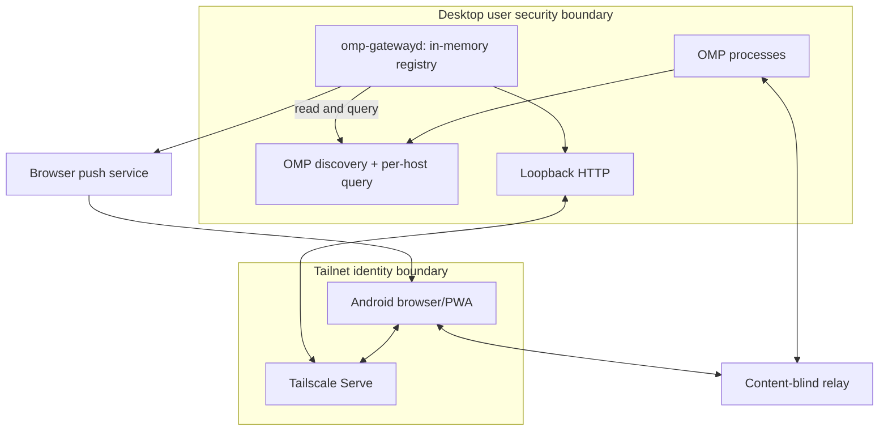

# Architecture

This document explains the components, runtime flows, trust boundaries, availability rules, and installation transactions of OMP Session Gateway for contributors working on the codebase.

On each host, interactive Oh My Pi (OMP) processes — each an OMP host (one running `omp` process) — publish local discovery files and owner-only query endpoints. Per-user `omp-gatewayd` polls local discovery, serves the **OMP Sessions** Progressive Web App (PWA) on loopback behind Tailscale Serve over tailnet HTTPS, coordinates Web Push alerts, and brokers collaboration links on explicit **View** or **Control** taps while browsers connect directly to OMP's encrypted collaboration relay.

Source-level file inventories are in the [gateway module map](../apps/gateway/README.md#module-map), the [web app module map](../apps/web/README.md#module-map), and the [protocol package overview](../packages/protocol/README.md).

## 1. Components

### 1.1 Mainline OMP discovery reader

Stock mainline OMP `>= 18.1.20` owns its collaboration controller and per-host local registry; no fork, custom OMP build, or gateway-specific OMP plugin is used. Operators enable `collab.autoStart` once and run plain `omp` alongside Bun 1.4.4 and TUN-mode Tailscale Serve; see [Mainline OMP integration](OMP_INTEGRATION.md).

`OmpHostReader` (`apps/gateway/src/omp-registry.ts`) reads discovery entries under `~/.omp/run/collab-hosts` (or configured `omp.discoveryDir`) and queries each entry's published `endpoint` with its per-host token. Because OMP relocates long socket paths, deriving a socket path from the JSON filename is invalid, and the gateway never writes, renames, or unlinks anything in the discovery directory.

Snapshot queries return metadata only, while OMP owns publication and cleanup independently of the gateway. File shapes and the one-request-per-connection wire contract are specified in [Wire and HTTP protocol](PROTOCOL.md).

### 1.2 Host poller and launch broker

`startHostPoller` (`HostPoller`) coalesces concurrent polls, reads OMP host snapshots, and reconciles the in-memory, metadata-only `SessionRegistry` (`apps/gateway/src/registry.ts`). `registry.heartbeatSeconds` is the gateway's discovery poll interval (default 10 seconds); OMP processes never push heartbeats to the gateway.

Hosts absent from discovery or failing with `ENOENT` or `ECONNREFUSED` are removed immediately; timeouts, `EMFILE`, `EACCES`, and wire errors such as `snapshot_unavailable` retain an existing card until `registry.ttlSeconds` (default 35 seconds) expires.

`OmpLaunchResolver` is the per-tap launch broker; a View or Control link is a bearer secret, called a capability in the contracts. After HTTP authorization, it checks the observed generation (OMP's counter that increments when a session is replaced, preventing a stale card from opening a newer session), the requested mode, and any attention `requestId`, then queries OMP's `link` operation and revalidates before returning (`access_unavailable` maps to `409 mode_unavailable`).

Capabilities exist in the gateway only during that per-launch query and `no-store` launch response and are never stored or cached in the registry.

When opt-in session creation in Tern (a terminal execution environment where interactive `omp` processes run; [Running OMP inside Tern](OMP_INTEGRATION.md#running-omp-inside-tern)) awaits a spawned session (`apps/gateway/src/tern-creation.ts`), it subscribes to stripped poller observations via `subscribeObservations` and requests `refreshForAdoption` rounds started after the spawn rather than reusing an older in-flight poll.

Reconciliation precedes observation publication, concurrent adoption requests coalesce into one round, cancellation drops only the caller's wait, and observations omit discovery tokens, endpoints, capabilities, full working directories, and Tern IDs.

### 1.3 `omp-gatewayd`

A per-user daemon (`omp-gatewayd`, invoked by `apps/gateway/src/cli.ts:runServe()`) is the sole local aggregator and remote authorization point on a host. Using `omp-gateway <command>` as shorthand for `bun apps/gateway/src/cli.js <command>` run from the extracted release archive (bundled from `cli.ts`), the CLI exposes `serve`, `install`, `uninstall`, `rollback`, `status`, `doctor`, `rotate-readiness-token`, `serve-guidance`, and `help`.

Daemon responsibilities (modules under `apps/gateway/src/`, per-user paths in [Paths](OPERATIONS.md#13-paths)):

- Read OMP discovery and query per-host endpoints, keeping `SessionRegistry` empty on startup until the first poll repopulates it.
- Serve the loopback-only HTTP API (`http.ts`, `http-policy.ts`), static PWA shell (`static.ts`), and pinned `collab-web` bundle, authorizing Tailscale Serve identities (`auth.ts`, `tailnet.ts`) against `auth.allowedLogins`.
- Serve same-origin `GET /api/v1/client-config` (`no-store`) and, when `http.trustedDashboardOrigins` is configured, admit browser-direct CORS requests from those exact origins only on the cross-origin routes ([Cross-origin access](PROTOCOL.md#cross-origin-access)), without server-side launch proxying.
- Return a single capability only on an explicit **View** or **Control** launch and stream metadata-only directory updates over Server-Sent Events (SSE).
- Persist private VAPID keys and owner-bound Push subscriptions in `<stateDir>/push-state.json` (`PushService` in `push.ts`) separately from the memory-only session registry, and send metadata-only Web Push envelopes.
- When `tern` is configured, start new interactive `omp` tabs from administrator-approved choices (`tern-creation.ts`, `tern-cli.ts`) and adopt them through OMP-native discovery ([ADR-043](DECISIONS.md#adr-043--opt-in-tern-creation-with-omp-native-adoption)).

`cli.ts:runServe()` owns `SessionCreationService`, `FleetSourceService`, `FleetCoordinator`, `PushService`, the poller, HTTP server, and clean shutdown, while `service.ts` manages OS login-service registration and `logger.ts` (`SafeLogger`) enforces numeric-and-boolean-only operational logs.

`tern-creation.ts` owns serialized admission, the capability-free `<stateDir>/session-creations.json` ledger, and adoption, and `tern-cli.ts` runs bounded subprocesses with lossless numeric-ID decoding and child cleanup.

Intent and checkpoints are persisted before dependent effects, restart classifies interrupted operations conservatively without re-spawning, and daemon shutdown never closes Tern tabs, kills `omp`, or touches OMP discovery.

#### Fleet notification source

For fleet notifications (background Web Push alerts from other hosts, coordinated by the home gateway under [ADR-048](DECISIONS.md#adr-048--fleet-notifications-through-the-home-gateway-as-coordinator)), a remote host acting as an alert source runs `FleetSourceService` (`apps/gateway/src/fleet-source.ts`). It maintains an atomic version-1 `<stateDir>/notification-grants.json` with serialized mutations, verifier-only secret storage, 30-day expiry, expired-entry pruning, and at most 16 grants, one per owner and coordinator origin.

- Browsers create, renew, or revoke grants only from an origin listed in both `notifications.coordinators` and `http.trustedDashboardOrigins`, while the source independently authenticates the Tailscale user login (`Tailscale-User-Login`) on that direct HTTPS request.
- A separate machine-authorization branch in `auth.ts` never reads Tailscale identity headers and admits bearer grant credentials only on `GET /api/v1/notification-feed`; measured Tailscale Serve topology is required even when a loopback browser harness sets `auth.trustIdentityWithoutTailnetDevice`.
- Each grant owns at most one live SSE connection with a 256-event queue, identifier-only session projection, 15-second heartbeat comments, and per-write authorization checks.
- `HostPoller.discoveryWarm` turns true only after healthy discovery reconciliation, so a cold source emits heartbeats rather than an empty snapshot; once warm, atomic registry subscription sends a `snapshot` before `upsert` or `remove` events, and `stop` events are live-only and revalidated against a `busy: true`-to-`false` edge before write.
- Grant revocation or replacement closes the active stream before persisting; write failure disables source authorization, and corrupt state preserves on-disk evidence and fails fleet routes with `503` while leaving ordinary directory and launch routes available.
- `doctor` reports boolean `notificationGrantsHealthy`, and diagnostics bundles never read `notification-grants.json` or the coordinator's `fleet-notifications.json`.

#### Fleet notification coordinator

`FleetCoordinator` (`apps/gateway/src/fleet-coordinator.ts`) runs on the home gateway and persists up to 32 owner-and-source grants, eight recipients keyed by endpoint SHA-256, and 256 outstanding request IDs per recipient in `<stateDir>/fleet-notifications.json`.

Before delivery it persists `max(previous epoch + 1, Unix seconds)` with one receipt counter across recipients in that epoch; `PushService` supplies owner-bound subscriptions, VAPID transport, and a shared eight-send semaphore to deliver Push v3 envelopes for local and selected remote sources while keeping `<stateDir>/push-state.json` and non-fleet Push v2 payloads intact.

- Each selected active grant runs one bounded SSE puller to its configured origin, sending only `Authorization` and `Accept: text/event-stream`, refusing redirects, bypassing HTTP proxies for configured hosts, and verifying the coordinator-bound owner digest on every snapshot.
- Activating a source waits at most 5 seconds for its first snapshot and otherwise reports `source_unreachable`; the other activation outcomes and their wire shapes are in [Fleet notifications](PROTOCOL.md#fleet-notifications).
- Network errors retain stale asks and back off from 1 second to 5 minutes; `401` and `404` clear that source's alerts and retry every 5 minutes.
- Once selected sources report or 30 seconds elapse, restart reconciliation compares persisted outstanding requests against live state, queuing exact `clear` messages first and unseen live requests second without sending `stop` messages or repeating unchanged remote requests; stale sources keep their persisted requests, and catch-up replay when a device changes its selected hosts is scoped to that device.
- Outstanding request sets mutate only after push acceptance, while volatile per-recipient reservations deduplicate queued or in-flight requests and count against the 256-item cap.
- Failed sends hold reservations across a per-delivery 30-second cooldown (`clear` retries reuse the exact envelope and sequence; failed attentions release for live reconciliation), skipped sends release immediately, and a full 256-entry delivery queue drops new attentions and stops while keeping deferred clears represented until space opens.
- Per-endpoint pacing waits at least 1 second after the previous settle before acquiring one of the eight send slots, serves other queued endpoints first, and rechecks owner, selection, grant, and expiry after acquiring the slot; corrupt or unwritable state fails fleet routes closed while local alerts continue on Push v2.

### 1.4 OMP Sessions PWA

The PWA (modules under `apps/web/src/`, user flows in [Using OMP Sessions](USAGE.md)) is a small session directory and capability launcher that never renders transcripts outside the embedded client or prefetches capabilities.

#### Directory metadata

Each directory card renders non-secret metadata only: session title (or working-folder basename, falling back to `OMP session`), project basename (full paths off by default), model slug, uptime or waiting duration, and sampled `Working` / `Idle` / `Activity unknown` state.

When OMP reports boolean `inputRequired: true`, the gateway mints an opaque `ask.requestId` and `ask.since` timestamp (producing the **Needs you** heading and `Waiting for your input` hero card summary without prompt or answer text), alongside actions for read-only **View**, **Open request**, **Hold for desk**, and reversible device-local **Hide**.

When zero sessions are live on fresh coverage, the directory renders **No live sessions** with `collab.autoStart` setup guidance instead of a zero-count list.

Device-scoped alert controls and build identity sit in the **Background alerts** tray (and its **Alert detail** and **Hosts** sections) opened from masthead **Settings**; **All clear** appends `Alerts are on for input requests and activity stops.` only when alerts cover the view and otherwise offers **Enable alerts to get pinged** (or **Alerts blocked · Settings**).

#### Fleet sources

On startup the page fetches same-origin `GET /api/v1/client-config` (`cache: "no-store"`, `credentials: "same-origin"`, `redirect: "error"`, 4-second timeout, 32 KiB `MAX_CLIENT_CONFIG_BYTES` cap). A `404` from a pre-fleet gateway runs in local-only mode with opt-in in-page speech recognition (`speech.browserRecognition`) disabled and no error banner.

A malformed or failed response keeps the local directory usable, creates no remote sources, and shows `Fleet configuration unavailable` with **Try again** in the top banner unless a local transport fault takes precedence, retrying automatically after local snapshot recovery.

For `local`, the page reads `GET /api/v1/sessions` and `GET /api/v1/events`. When `fleet.targets` configures up to seven remote hosts (eight sources total with `local`), the browser polls each remote `GET <origin>/api/v1/sessions` directly (`mode: "cors"`, `credentials: "omit"`, `cache: "no-store"`, `redirect: "error"`, 5-second timeout, 8 MiB response cap) on visible start and every 10 seconds while visible, with one in-flight request per source and jittered 1-to-30-second failure backoff.

The browser never opens remote `EventSource` streams or calls remote `client-config`, `health`, or `push` endpoints. In `fleet.ts`, sessions are keyed in page memory from `client-config` source `id` and `origin` values as `SourceKey = id + "\0" + origin` and `SessionRef = { sourceKey, instanceId, generation, requestId? }`, never concatenating `SourceKey` into `instanceId` on the wire.

The **Host** `<select>` filters the view without changing background polling: **All hosts** orders waiting sessions by when this browser first observed each exact request (avoiding cross-host clock skew), a single host uses `ask.since` FIFO, and directory rows show host labels only when multiple hosts are in view.

#### Availability model

`availability.ts` defines the pure eight-state source model (`loading`, `fresh`, `refreshing`, `stale`, `expired`, `unavailable`, `forbidden`, `withdrawn`). `fleet.ts` owns polling and the 35-second `stale`-to-`expired` grace window (retiring stale rows into a `Host unavailable` row), and `app.ts` arbitrates notices across the top banner, per-host rows (`#fleet-status` in `index.html`), and the open session's bottom triage bar ([Availability ownership](BRANDING.md#availability-ownership)):

- The top banner owns device and local-gateway connectivity plus failed `client-config` bootstrap (with local transport faults taking precedence over bootstrap failure), while `#fleet-status` host rows name only independently failed remote sources.
- Remote `403`, `404`, `409`, and transport launch failures stay on that remote source's host row without replacing an independent local banner; `Refresh host` checks the source's session list and never replays a capability `POST`.
- A scheduled retry keeps an established local fault named even before the first snapshot, and hiding the page, expiring remote rows, or opening a remote session cannot clear that local fault or stop its retry chain; only a fresh local snapshot or a replacement local fault changes it, while bootstrap recovery updates the local source's label in place so accepted creation intents keep their origin-bound identity.
- Going offline marks remote sources `stale` while preserving their observation clocks, grace timers, and scheduled reconnects (recovery never depends on an `online` event), whereas hiding or freezing aborts in-flight fetches without recording a failure.
- Any local `403` on list, launch, creation, or embedded probe triggers one `withdrawn` transition that clears local rows and clocks, advances the SSE epoch, closes the stream, cancels local work, and ignores late pre-denial events until a fresh authorized snapshot arrives; a readable remote `403` clears that source's rows, disposes its open shell, and pauses automatic polling until foreground or online revalidation.
- **All clear** and **No live sessions** require every source in scope to be `fresh` (plus current alert coverage for **All clear**). Availability descriptors store the exact observation instant alongside formatted hour-and-minute text: `withdrawn` invalidates the prior clock, **All hosts** shares an empty clock only when underlying observation instants match, and an independently observed empty remote source remains visible when local access is withdrawn.
- Every launch or creation wizard open advances the selection epoch so a newer intent (even if it fails) supersedes an older resume, and accepted launches revalidate **View** or **Control** eligibility (`mode_unavailable` names the withdrawn mode instead of mounting) as well as source, generation, and `requestId`.
- Denying, failing, or cancelling an **Open request** loading tray before the client mounts restores the directory snapshot without an extra fetch, except `pagehide`, which retains metadata-only resume intent so back-forward cache (`bfcache`) `pageshow` revalidates the target source's own freshness (even during local `403` withdrawal) and reacquires a fresh capability.
- During **Next ask →** or **Hold → next** in the collaboration triage bar, the target owns failure notices across predecessor health or Hold updates until **Sessions**, explicit dismissal, a new launch, or a fresh target observation releases it; active in-flight launches suppress Hold reconciliation, and dismissing an expired-target notice restores **Hold → next** immediately.

#### Local triage storage

**Hold for desk** and **Hide** are device-local presentation layers persisted in `localStorage` under `omp.sessions.held-asks.v2` and `omp.sessions.dismissed.v2` (at most 100 records and 512,000 characters each; full key inventory in [Browser storage](../apps/web/README.md#browser-storage)). Legacy `.v1` keys migrate to `sourceId: "local"` and are deleted only after the `.v2` write succeeds; records for removed or origin-rebound sources are pruned only after an authoritative bootstrap.

Holding skips a request in this device's queue without clearing gateway attention, reducing the home `pendingAskCount` (Push v2) or `badge.count` (Push v3), or closing home notifications on a remote `instanceId` collision, and in-session **Hold → next** commits only after the next launch succeeds.

Authoritative snapshots and upserts drop a held record when its `requestId` clears or changes and drop a dismissal when the session disappears, changes generation, or requires input, whereas transport failures preserve both; sampled `busy` never implies completion, and storage never holds titles, paths, models, prompts, transcripts, or capabilities.

#### Background alerts and activity stops

Web Push requires an explicit action in **Background alerts** and never prompts on page load. The home gateway sends Push v2 (`version: 2`) envelopes for local-only subscriptions and Push v3 (`version: 3`) envelopes when fleet notifications are enabled.

**Private** sends a fixed title with no body, **Session** (default) adds session and project labels locally or `<host label> · <6-char instanceId suffix>` for remote fleet sources, and **Preview** falls back to **Session** because stock OMP publishes no prompt preview.

`SessionRegistry` detects `busy: true` to `busy: false` edges on a continuing `instanceId` and `generation` (retained polls clear activity knowledge without extending TTL, and neither a prior nor current `inputRequired` sample can emit a stop).

Activity-stop events share the ordered push dispatch queue with a record-local revision marker that cancels stale stops across busy, unknown, or identity transitions, are never broadcast over browser SSE, and always open read-only **View** on tap ([Attention and notification specification](ATTENTION_SPEC.md)).

#### Shell updates and caching

The service worker precaches the content-hashed application shell — including the pinned `collab-client` module, stylesheet, and upright Geist faces — while an idle directory preloads the client module so taps pay only for the capability `POST` and relay handshake.

Session-title Private Use Area glyphs use first-party Symbols Nerd Font Mono WOFF2 chunks split by `unicode-range`, downloaded on demand with the italic Geist face and cached in the active shell cache after first fetch ([Service worker](../apps/web/README.md#service-worker)).

Activating a new worker deletes prior shell caches and calls `clients.claim()` without navigating windows because Chromium reports a window client's initial URL rather than history-API routes such as `/client/` ([ADR-018](DECISIONS.md#adr-018--activate-pwa-upgrades-automatically-without-interrupting-live-collaboration)).

Open pages listen for `controllerchange` and reload after 1 second only when no launch, routed notification, or collaboration shell is active, applying deferred updates once collaboration exits; `http.ts` and `app.ts` also scrub `no-store` `/update/` requests to `/` for pre-ADR-018 workers that navigated on upgrade.

### 1.5 Existing OMP collaboration client

`packages/collab-client` embeds a pinned upstream OMP `packages/collab-web` source snapshot and `@oh-my-pi/pi-wire` dependency rather than reimplementing transcripts, tool cards, subagent controls, the relay protocol, or end-to-end encryption ([Embedded collaboration client](../packages/collab-client/README.md)).

The bundle vendors only the pure TypeScript `@oh-my-pi/pi-utils` Markdown and math/list helpers so `@oh-my-pi/pi-natives` never enters the browser build.

The PWA mounts `startCollabWithCapability` (`packages/collab-client/upstream/src/embed.ts`) in the same document on the gateway origin, keeping the capability in JavaScript memory only, disposing all references on exit, and returning to the directory on reload instead of reading URL fragments or history.

Installed PWAs always use this same-document mount because standalone windows need not preserve `window.opener`; a same-origin child window with `MessageChannel` and `postMessage` transfer is valid only where an exact-origin opener exists.

In writable **Control** sessions, **Photo** exposes separate **Take photo** (`capture="environment"`) and **Choose existing** inputs for up to four JPEG, PNG, or WebP images, rejecting sources over 8,192 px per edge or 20 megapixels and canvas-re-encoding each in memory to an EXIF-free JPEG within 2,048 px and 1 MiB.

Images travel with the optional text note over OMP's encrypted v3 `prompt.images` relay frame and stay staged in the composer until the host transcript echoes receipt, adding no gateway HTTP route, storage key, or unencrypted hop.

`app.ts` passes two `CollabEmbedOptions` hooks to `startCollabWithCapability`:

- `probeGateway` replaces the client's default same-origin `GET /api/v1/health` probe with a coalesced `GET <source>/api/v1/sessions` check returning `"healthy"` on a valid session list, `"forbidden"` on a readable `403` (halting relay refresh and automatic probe retries), and `"unavailable"` otherwise.
- `browserRecognitionEnabled` mirrors the home gateway's `speech.browserRecognition` setting ([ADR-037](DECISIONS.md#adr-037--speech-input-keyboard-dictation-baseline-and-opt-in-browser-speech-recognition)), switching document `Permissions-Policy` from `microphone=()` to `microphone=(self)` and enabling the opt-in Web Speech control in writable **Control** only, where **Use text** populates the composer draft and **Send** remains a separate action.

### 1.6 Relay

OMP's default encrypted collaboration relay is the only supported relay path: OMP seals collaboration frames end-to-end before they touch the WebSocket, and `omp-gatewayd` never proxies collaboration WebSockets. Self-hosted or custom-proxied relays are outside the supported deployment contract; see [Unsupported deployments](OPERATIONS.md#15-unsupported-deployments).

## 2. Runtime flow

### 2.1 Desktop login

1. The OS login manager starts `omp-gatewayd` as the desktop user.
2. The daemon atomically loads or creates its private `readiness-token` for CLI readiness challenges.
3. It begins polling OMP's local discovery directory as a read-only client.
4. It binds the HTTP server to loopback (for example `127.0.0.1:4317`).
5. Persistent Tailscale Serve proxies tailnet HTTPS traffic to that loopback listener.

### 2.2 OMP process start

1. Interactive `omp` initializes its session context and, when `collab.autoStart` is `view` or `control`, starts its collaboration controller.
2. OMP writes its discovery JSON and binds its owner-only per-host query endpoint.
3. The next `omp-gatewayd` poll queries `snapshot` and reconciles the session card in `SessionRegistry`.
4. A changed registry revision broadcasts metadata-only SSE, and open **OMP Sessions** pages render the row.

OMP snapshots provide boolean `inputRequired` without prompt or answer text. Each `false`-to-`true` edge mints one opaque in-memory `ask.requestId` and `ask.since` timestamp, retained across consecutive `true` polls and discarded on `false`, removal, TTL expiry, or generation change.

### 2.3 Background attention push

1. From **Background alerts**, the user taps **Enable background alerts** and posts the browser subscription and detail level (`private`, `session`, or `preview`) to `POST /api/v1/push/subscription`.
2. `PushService` stores the VAPID key pair, subscription endpoint and keys, authenticated Tailscale login, and detail choice in `<stateDir>/push-state.json`; opting into **Settings → Hosts** also records recipient source selections in `<stateDir>/fleet-notifications.json`.
3. Control-capable attention edges, clears, and activity-stop edges emit encrypted, capability-free Push v2 envelopes (`version: 2`, local-only devices) or Push v3 envelopes (`version: 3`, fleet-enabled devices covering local and selected remote sources).
4. The browser push service wakes `service-worker.ts`, which persists ordering and tombstones in IndexedDB (`omp-notification-ordering`), tags one notification per source and instance, updates the app badge, and closes matching tags on `clear`.
5. On `notificationclick` (`apps/web/src/service-worker.ts`), if a same-origin window client exists, the worker calls `client.focus()` and sends `omp-notification-route` via `postMessage` over a `MessageChannel`, waiting up to 3 seconds for `omp-notification-route-accepted` so the open page revalidates fresh metadata and switches or keeps the live session in place without navigating.
6. With no open same-origin window or no acceptance within 3 seconds, the worker calls `clients.openWindow()` with `/collab/:instanceId?request=:requestId` (attention) or `/collab/:instanceId?activity=stopped&generation=:generation` (activity stop), appending `&source=:binding` for a remote fleet alert; on load, `app.ts` scrubs `/collab/...` to `/` before revalidating fresh metadata for **Control** or **View**.

### 2.4 View or Control launch

1. The user taps a session row (**View**), **Open request**, or **Control**.
2. `app.ts` records the launch intent in memory: full-screen launches switch to `/client/` on mount, whereas **Open request** mounts inside the native tray and updates the URL to `/client/` only when **Expand** promotes the live shell without remounting; `controllerchange` reloads wait until launches and sessions finish.
3. The browser sends `POST <source>/api/v1/sessions/:instanceId/launch` (`no-store`) with the observed `generation`, `mode`, and optional `requestId`.
4. The target gateway verifies Tailscale identity, `auth.allowedLogins`, `Origin`, Fetch Metadata, content type, rate limits, freshness, generation, and mode availability.
5. `OmpLaunchResolver` queries OMP's `link` operation for that exact generation and mode, revalidates registry state, and returns one capability in the `no-store` JSON body without retaining it.
6. `app.ts` passes the capability in memory to `startCollabWithCapability`, which connects directly to the relay encoded in the link; leaving or reloading drops all references and returns to the directory.

### 2.5 Session switch, resume, or branch

OMP owns session replacement and increments `generation` before publishing the replacement snapshot. `omp-gatewayd` updates the existing `instanceId` card in place, and any launch carrying the superseded generation fails (`stale_generation` from OMP's `link` query, returned as HTTP `409 generation_mismatch`) rather than opening the newer session.

### 2.6 Crash and stale cleanup

`SessionRegistry` tracks observation age on a monotonic clock: missing discovery files or `ENOENT` / `ECONNREFUSED` socket errors remove the card immediately, while transient query errors retain it until `registry.ttlSeconds` (default 35 seconds) expires. Closing the per-host socket after one reply is normal OMP wire behavior, and card removal mutates memory before SSE emission without touching OMP-owned files.

## 3. Trust boundaries

Processes running under the same OS user share the desktop security boundary and can read that user's files or query OMP directly; private directory modes and per-host tokens prevent cross-user access and accidental misuse rather than sandboxing same-user malware.

An unlocked or compromised device with an allowlisted tailnet login can launch sessions until tailnet access or `auth.allowedLogins` is revoked. Passkey or WebAuthn step-up verification (explored in [ADR-008](DECISIONS.md#adr-008--optional-webauthn-gate-not-native-biometrics)) is not implemented; full threat-model invariants are in [Threat model](./SECURITY.md#3-threat-model).

## 4. Why not process scanning or terminal automation?

Process enumeration can locate PIDs, but it cannot attach OMP's encrypted collaboration protocol to a live session context or extract a capability without reading process memory. Keystroke injection, PTY or screen scraping, QR decoding, and clipboard polling are brittle and introduce uncontrolled secret channels.

Stock OMP publishes the exact local discovery and per-launch link interface the gateway needs, including when `omp` runs inside Tern ([ADR-038](DECISIONS.md#adr-038--tern-is-an-execution-environment-not-an-integration), amended by [ADR-043](DECISIONS.md#adr-043--opt-in-tern-creation-with-omp-native-adoption)).

When `tern` session creation is enabled, the gateway starts a tab from administrator-authored `argv` and working-copy IDs and correlates `tern inspect --json` pane and `omp_session_file` basename metadata. It never reads session files, Tern Surface Protocol (`tsp.ts` in `@oh-my-pi/pi-wire`) frames, or terminal output, never injects keystrokes, and never substitutes Tern IDs for OMP's `(instanceId, generation)` identity.

## 5. Availability behavior

- Gateway unavailable: OMP collaboration and local discovery continue unaffected; an open session measures same-origin gateway reachability with adaptive RTT probes and reports `Gateway unavailable` without exposing session data.
- Relay unavailable: directory cards stay visible, while open sessions probe the encrypted host channel (10-second handshake bound; two missed idle probes replace the socket) and report `Relay unavailable` without exposing the capability.
- Tailscale unavailable on the client device: requests fail closed with no public fallback.
- Host asleep or offline: a loaded page retains last-seen metadata in volatile memory, marks rows stale with their observation timestamp, and retries automatically; authorization denial (`403`) clears retained metadata immediately.
- Directory SSE silence: after 12 seconds without frames or heartbeats, the page closes the stream and fetches a fresh snapshot without clearing retained cards ([Revisions and races](PROTOCOL.md#7-revisions-and-races)).
- Radio or network transitions in an open session: lifecycle and network signals trigger probes rather than assuming health; hidden pages pause relay probes, and foreground gateway recovery requires two healthy checks and replaces the relay socket after the first.
- Ended collaboration state: recovery timers and listeners stop immediately so the ended notice and return action stay stable.
- Gateway restart: `omp-gatewayd` starts with an empty registry and rediscovers running OMP hosts on its first poll without OMP reconnects or `/collab` commands.
- OMP crash or exit: missing discovery, `ENOENT` / `ECONNREFUSED`, or TTL expiry removes the card.
- Browser reload vs `pagehide` / `pageshow`: reload drops the JavaScript heap and returns to the directory, whereas `pagehide` disposes the live client and drops its capability while keeping a metadata-only resume target so persisted `pageshow` revalidates the directory and requests a fresh capability when `(sourceKey, instanceId, generation)` and access match ([ADR-029](DECISIONS.md#adr-029--resume-a-backgrounded-session-by-relaunching-it-never-by-retaining-its-capability)).
- Push delayed or unavailable: directory polling, SSE, and explicit launches work normally; Web Push is best-effort and never bypasses current-state revalidation.

## 6. Installation transactions

### 6.1 Staging, readiness proof, and activation

`omp-gateway install` snapshots any existing `config.json`, validates any prior managed service and staged runtime, and refuses to proceed if an unmanaged service or authenticated foreground process occupies the prior or requested loopback port.

Upgrades avoid rewriting unchanged configuration bytes, delete any pre-v0.3.0 `<configDir>/publisher-token` file, repair a missing or unreadable `readiness-token` only when the prior service is inactive and its port is free, and preserve authored configuration sections as listed in [Updates and rollback](OPERATIONS.md#10-updates-and-rollback).

The installer stages the release payload into `<stateDir>/installation/versions/<version>-<sha256-12>` with `installation.json` (`version`, full payload SHA-256 digest, and `"readinessProtocol": "instance-v1"`), revalidating existing directories in place.

Unless `--no-start` is passed, `install` mints a one-time 256-bit base64url `--readiness-instance` nonce, registers and starts the user service with that nonce, and polls `GET /api/v1/health` with `X-OMP-Readiness-Challenge` (15-second deadline on Linux and macOS; 60 seconds on Windows for cold PowerShell ACL checks), requiring an HMAC-SHA256 over `<challenge>\0<instance>` keyed by `readiness-token`.

Only after that instance-bound readiness proof succeeds does `install` advance `<stateDir>/installation/current.json` and append to `installation/history.json` (bounded to 64 entries and 4,096 bytes). Any failure in configuration, service registration, startup, readiness, or pointer activation restores the prior `config.json`, service definition, running state, and verified runtime.

### 6.2 Staged-runtime pruning

After a readiness-proven `install` commits `current.json` and `history.json`, `pruneSupersededRuntimes` (`apps/gateway/src/installation.ts`) cleans superseded payloads under `<stateDir>/installation/versions`:

- Retention keeps the active runtime, the two most recent distinct predecessors in `history.json` (three distinct activations total, so `A → B → A` occupies two slots), the predecessor plain `rollback` selects, and any directory referenced by the on-disk service definition in raw, XML-escaped, or JSON-escaped form.
- Only `<version>-<hex12>` directories and `.prune-<uuid>` renamed directories directly under the private `versions` root are eligible; foreign names, non-directories, symlinks (including inside payloads), and invalid metadata are skipped.
- Each victim is renamed to `.prune-<uuid>` inside `versions/` so `rollback` can never select it, then unlinked across at most 4,096 `versions/` entries, 4,096 entries per payload, and 32 directory levels.
- Pruning never runs on failed installs, `install --no-start`, `rollback`, or `uninstall`; cleanup errors are counted in `Staged runtimes: retained <n>, removed <n>, failed <n>` without reverting a committed install.

### 6.3 Rollback, token rotation, and uninstall

- `rollback [--to <version-dir>]` resolves the previous distinct directory in `history.json` (or `--to`), revalidates its manifest and SHA-256 digest, backs up `config.json` to `<configDir>/config.pre-rollback.json`, and strips newer sections ([Roll back to a retained predecessor](UPGRADE_ROLLBACK.md#roll-back-to-a-retained-predecessor)). If readiness fails, it restores `config.json`, rebuilds the service from `current.json`, and re-proves readiness on the prior runtime.
- `rotate-readiness-token` verifies service ownership and the active runtime, atomically writes a fresh `readiness-token` (refusing non-files or unsafe parent directories), and restarts the active service; if readiness fails on the new token, it stops the service fail-closed and keeps the new token rather than restoring the old one.
- `uninstall [--no-stop]` derives the user service path without parsing `config.json`, stops the service (`--no-stop` is accepted only when already inactive), and removes autostart registration while leaving `config.json`, `readiness-token`, `push-state.json`, fleet and creation state files, and staged runtimes intact ([Paths](OPERATIONS.md#13-paths)).

## Related documents

Synthetic visual-review serialization, 21-case geometry checks, and Percy log-redaction guards are documented in [Percy data flow](BROWSERSTACK.md#percy-data-flow).

Release campaign receipts, retry authority, readiness sidecars, and remote-owner cleanup fencing belong to the POSIX release driver and are documented in [Qualification attempt ownership](RELEASE.md#qualification-attempt-ownership).

- [Wire and HTTP protocol](PROTOCOL.md) — discovery files, per-host socket queries, browser HTTP/SSE/CORS contracts, session creation, and Push v2 and v3 schemas.
- [Security design and threat model](./SECURITY.md#1-security-objective) — assets, capability lifetime, tailnet and browser controls, and logging invariants.
- [Mainline OMP integration](OMP_INTEGRATION.md) — stock OMP settings, discovery lifecycle, and running `omp` inside Tern.
- [Architectural decisions](DECISIONS.md) — numbered ADRs recording the rationale behind each boundary.
